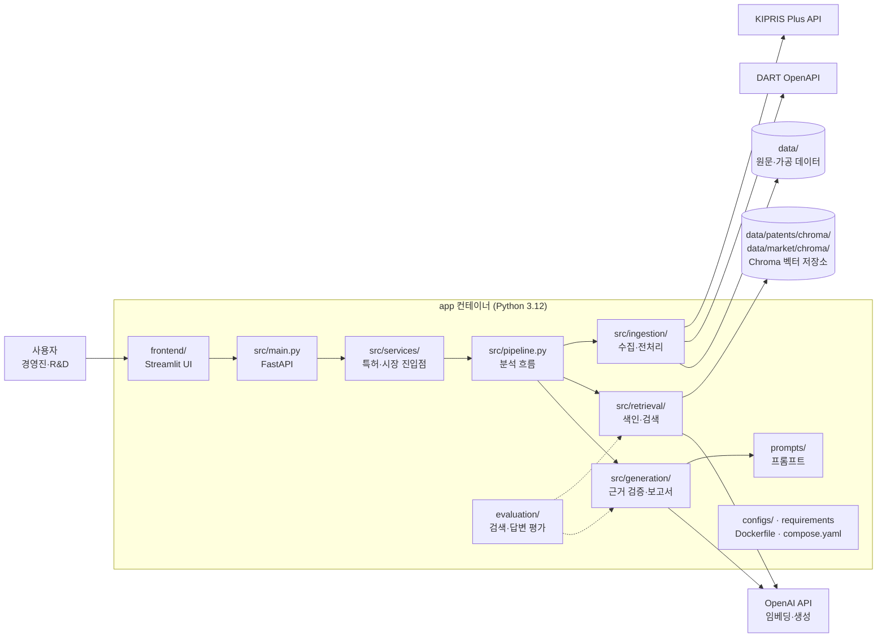

# 시스템 설계

## 서비스 연결 구조

- 계획 기준의 모듈·외부 서비스 연결 구조. 실제 구현이 바뀌면 함께 갱신한다.
- 로컬 개발은 Docker `app` 컨테이너 하나에서 실행하며, 벡터 저장소는 로컬 Chroma(특허 `data/patents/chroma/`, 시장 `data/market/chroma/`)를 사용한다.
- `%% map <경로> <노드ID>` 주석은 Notion PR 문서화 자동화가 변경 파일에 해당하는 노드를 강조할 때 사용한다. 새 모듈을 추가하면 노드와 매핑을 함께 추가한다.



## 디렉토리 구조

```text
IdeaLens/
│
├── configs/
│   └── settings.py              # 공통 환경변수·설정
│
├── data/
│   ├── patents/
│   │   ├── raw/                 # KIPRIS 원본 응답
│   │   ├── processed/           # 정제된 특허 JSON
│   │   └── chroma/              # 특허 벡터 DB
│   ├── market/
│   │   ├── raw/                 # 시장 원본 자료
│   │   ├── processed/           # 정제된 시장 근거
│   │   └── chroma/              # 시장 근거 벡터 DB
│   └── samples/
│       └── ideas.json           # 시연용 아이디어 5개
│
├── docs/
│   ├── architecture.md          # 전체 시스템 설계
│   ├── api_contract.md          # 공통 API 명세
│   ├── patent_rag.md            # 특허 RAG 설계
│   └── market_research.md       # 시장 조사 설계
│
├── evaluation/
│   ├── patent_cases.json        # 특허 검색 평가 사례
│   ├── market_cases.json        # 시장 근거 평가 사례
│   └── evaluate.py              # 통합 평가 실행
│
├── prompts/
│   ├── idea_parser.md           # 아이디어 구조화
│   ├── patent_analysis.md       # 특허 비교
│   ├── market_analysis.md       # 시장 근거 분석
│   └── report_generation.md     # 최종 보고서
│
├── reports/
│   └── .gitkeep
│
├── src/
│   ├── __init__.py
│   ├── main.py                  # FastAPI
│   ├── schemas.py               # 공통 데이터 모델
│   ├── pipeline.py              # 전체 분석 흐름
│   │
│   ├── ingestion/
│   │   ├── __init__.py
│   │   ├── kipris_client.py     # 특허 API 호출
│   │   ├── patent_processor.py  # 특허 정제·청킹
│   │   ├── dart_client.py       # DART 공시 수집
│   │   └── market_processor.py  # 시장 자료 정제
│   │
│   ├── retrieval/
│   │   ├── __init__.py
│   │   ├── patent_store.py      # ChromaDB 색인
│   │   ├── patent_search.py     # 특허 검색·재정렬
│   │   └── market_search.py     # 시장 근거 검색
│   │
│   ├── generation/
│   │   ├── __init__.py
│   │   ├── idea_parser.py       # 아이디어 구조화
│   │   ├── patent_analysis.py   # 선행특허 비교
│   │   ├── market_analysis.py   # 시장 신호 분석
│   │   └── report_builder.py    # 최종 보고서 구성
│   │
│   └── services/
│       ├── __init__.py
│       ├── patent_service.py    # 특허 RAG 진입점
│       └── market_service.py    # 시장 조사 진입점
│
├── frontend/
│   └── app.py                   # Streamlit
│
├── tests/
│   ├── test_patent.py
│   ├── test_market.py
│   ├── test_scoring.py
│   └── test_api.py
│
├── scripts/
│   ├── collect_patents.py       # 초기 특허 수집
│   └── build_patent_index.py    # 벡터 색인 생성
│
├── .env.example
├── .gitignore
├── AGENTS.md
├── README.md
└── requirements.txt
```

## .gitignore 필수 목록 (현재 폴더 구조 기준)

```gitignore
# Python
.venv/
__pycache__/
*.pyc
.pytest_cache/

# Secrets
.env
.env.*
!.env.example

# Local vector database
data/patents/chroma/*
!data/patents/chroma/.gitkeep

# Generated data
data/patents/raw/*
!data/patents/raw/.gitkeep
data/market/raw/*
!data/market/raw/.gitkeep

# OS
.DS_Store
```
