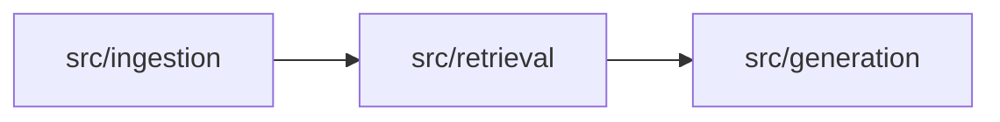

# 개발 환경 가이드

README의 실행 방법을 보완하는 상세 문서. 개발 환경, 코드 포맷, CI, PR 자동화의 동작과 설정 방법을 정리한다.

## Docker 개발 환경

| 파일 | 역할 |
|---|---|
| `Dockerfile` | `base`(실행 의존성) → `dev`(black·pytest·pre-commit·git, 비루트 사용자 `app`) 2단계 이미지 |
| `compose.yaml` | `app` 개발 컨테이너. 저장소를 `/app`에 마운트하고 `.env`가 있으면 환경변수로 읽는다 |
| `.dockerignore` | `.env`, `data/`, `reports/` 등을 빌드 컨텍스트에서 제외 |
| `Makefile` | `make up`, `make test`, `make format` 등 공용 명령 |

- 벡터 저장소는 로컬 Chroma(`data/patents/chroma/`)를 사용하며 별도 DB 컨테이너는 두지 않는다.
- 컨테이너 사용자는 UID 1000이다. Linux에서 호스트 UID가 다르면 `docker compose build --build-arg APP_UID=$(id -u) --build-arg APP_GID=$(id -g) app`으로 다시 빌드한다.
- Windows에서 `make`가 없으면 README의 `docker compose` 명령을 직접 실행한다.

## 코드 포맷 (black)

```bash
make format         # docker compose run --rm app black .
make format-check   # CI와 같은 검사
```

- 설정은 `pyproject.toml`의 `[tool.black]`에 있다(줄 길이 88, Python 3.12 대상).
- black 버전은 `requirements-dev.txt`와 `.pre-commit-config.yaml` 두 곳에 같은 값으로 고정한다. 버전을 올릴 때는 두 파일을 함께 수정한다.
- `required-version = "26"`이므로 다른 주 버전의 black은 실행이 거부된다. black은 매년 1월 주 버전에서만 안정 스타일을 바꾸므로, 주 버전을 올릴 때는 `required-version`도 함께 바꾸고 전체 포맷을 한 번에 적용한다.
- VS Code는 `.vscode/settings.json`에 따라 저장 시 black을 적용한다. 권장 확장은 `.vscode/extensions.json`에 있다.

## pre-commit

```bash
pip install -r requirements-dev.txt   # 호스트 가상환경 기준
pre-commit install                    # 커밋 시 자동 검사 등록
pre-commit run --all-files            # 전체 파일 검사 (make precommit)
```

검사 항목: black, 병합 충돌 표시, YAML·TOML 문법, 1MB 초과 파일, 개인키, 파일 끝 개행, 줄끝 공백.

## CI (`.github/workflows/ci.yml`)

| job | 내용 |
|---|---|
| `format` | `requirements-dev.txt`에 고정된 black으로 `black --check --diff .` |
| `test` | `python -m pytest`. 수집된 테스트가 없으면(종료 코드 5) 통과 처리 |
| `scripts` | `node --test "scripts/**/*.test.mjs"` — Notion·리뷰어·PR 분석 자동화 테스트 |
| `docker` | `docker compose config` 검증과 `app` 이미지 빌드 |

## PR 리뷰어 자동 지정 (`.github/workflows/assign-reviewer.yml`)

- PR이 열리거나 초안에서 전환되거나 리뷰 요청이 해제되어 **리뷰어가 0명**이 되면, 작성자를 제외한 후보 중 한 명을 무작위로 지정한다.
- 이미 리뷰어가 요청되어 있거나 작성자 외 리뷰가 있으면 변경하지 않는다.
- 후보 기본값은 저장소 협업자 GitHub ID 목록이며, 저장소 **Settings → Secrets and variables → Actions → Variables**에 `REVIEWER_POOL`(쉼표 구분)을 만들면 그 값을 우선한다.
- 후보 전원에게 요청이 실패하면 job이 실패로 표시된다.
- `pull_request_target`으로 실행되며 PR 코드가 아닌 base 브랜치의 `scripts/github/`만 체크아웃한다.

## Notion PR 문서화 (`.github/workflows/notion-pr-documentation.yml`)

develop에 병합된 PR마다 Notion의 `GitHub PR 자동 문서화` 페이지 아래에 기록한다. 같은 제목의 기록이 있으면 새로 만들지 않는다.

### 페이지 구성

1. 요약 callout: PR 번호·작성자·브랜치·병합 시각(KST)·변경 규모
2. PR 정보: PR·작성자·병합 커밋·자동화 실행 링크
3. PR 설명: 본문 마크다운을 Notion 블록(제목·목록·체크박스·표·인용·코드·mermaid)으로 변환
4. PR 설명 원문: 토글 안의 markdown 코드 블록
5. 커밋·변경 파일: 코드 블록
6. 변경 구조 다이어그램: 변경 파일 경로·상태로 만든 mermaid
7. 서비스 연결 구조: `docs/architecture.md` 다이어그램에서 변경 모듈을 강조한 mermaid
8. 문서화 검토 후보와 해석 범위

### PR 설명에 다이어그램 넣기

PR 설명에 mermaid 코드 블록을 쓰면 GitHub와 Notion 페이지에 모두 기록된다.

````markdown

````

- HTML 주석(`<!-- -->`) 안에는 mermaid 화살표 `-->`를 쓰지 않는다. 주석이 그 위치에서 끝난다.

### 서비스 연결 다이어그램 강조 규칙

- `docs/architecture.md`의 mermaid 다이어그램에 있는 `%% map <경로> <노드ID>` 주석으로 변경 파일과 노드를 연결한다.
- `/`로 끝나는 경로는 하위 파일 전체, 그 외에는 해당 파일(또는 같은 이름의 디렉터리)과 일치한다.
- 새 모듈을 추가하면 다이어그램 노드와 `%% map` 줄을 함께 추가한다.

### 미리보기와 수동 실행

```bash
make notion-preview PR=5                       # Notion을 호출하지 않고 페이지 구성을 JSON으로 출력
NOTION_DRY_RUN=1 NOTION_DRY_RUN_OUTPUT=preview.json PR_NUMBER=5 \
  GITHUB_REPOSITORY=<owner>/<repo> node scripts/create_notion_pr_page.mjs
```

- 미리보기는 병합 전 PR에도 사용할 수 있다. `gh` CLI 로그인 상태면 그 토큰으로 GitHub API를 호출한다.
- 실제 기록은 저장소 **Actions → Notion PR Documentation → Run workflow**에서 병합된 PR 번호로 실행할 수 있다.
- 워크플로는 항상 `develop`의 스크립트를 사용하므로, 스크립트 변경은 develop 병합 후에 반영된다.

### 제약

- Notion API 요청 제한(rich text 2000자, 배열 100개, 중첩 2단계, 요청당 1000블록·500KB)에 맞춰 블록을 나누어 추가한다. 추가 중 실패하면 미완성 페이지를 휴지통으로 옮기므로 다시 실행할 수 있다.
- Notion API에는 mermaid 코드 블록의 표시 방식(코드·미리보기)을 지정하는 필드가 없다. 다이어그램이 코드로 보이면 Notion에서 블록의 표시 방식을 미리보기로 바꾼다.

### 설정

1. Notion 내부 연결을 `GitHub PR 자동 문서화` 페이지에만 공유한다.
2. Notion API 토큰을 저장소 **Settings → Secrets and variables → Actions → New repository secret**에서 `NOTION_API_TOKEN` 이름으로 저장한다.
3. Notion 연결에 읽기와 삽입 권한이 켜져 있는지 확인한다.

토큰을 채팅, 코드, README 또는 커밋에 넣지 않는다.

## PR 자동 분석 (`.github/workflows/pr-analysis.yml`)

develop 대상 PR이 열리거나(`opened`·`reopened`) 초안·검토 요청 상태가 바뀌거나(`converted_to_draft`·`ready_for_review`) 수정본이 올라오면(`synchronize`) 초안 여부와 관계없이 PR을 분석해 Notion `RAG 기반 미니 프로젝트: IdeaLens` 바로 아래의 `PR 분석` 표에 PR별 보고서를 기록한다. PR이 병합되면 같은 위치의 `영역 요약 카드` 표를 갱신해 다음 분석의 출발점으로 쓴다. 참고용이며 승인·병합·GitHub 댓글·라벨은 하지 않는다. 필수 체크가 아니다.

### 처리 순서

1. 초안 PR도 일반 PR과 같이 분석·기록하며 준비 상태는 `⚪ 초안`이다. `Ready for review`나 초안 전환처럼 코드는 같고 초안 여부만 바뀌면 AI를 다시 부르지 않고 바뀐 준비 상태로 새 행을 쓴다. 닫히거나 병합되면 같은 PR의 진행 중인 분석이 끝난 뒤 행 상태만 바꾸고, 병합이면 이어서 `cards` job이 영역 요약 카드를 갱신한다.
2. 같은 head를 같은 초안 여부로 이미 분석했으면 건너뛰고, 실행 요약에 그 사실을 남긴다.
3. 태그·키워드: 변경 파일마다 서비스 계층 태그를 붙인다(안내서 '태그 규칙'이 먼저, 없으면 `docs/architecture.md`의 `%% map` 매핑). 키워드는 변경 파일 이름에서 3자 이상 영문 단어를 뽑는다(test·init·main·index·readme·requirements·src 제외).
4. 규칙 점검: PR 양식, 체크 표시와 CI 결과, 비밀값(최종 변경과 커밋 기록, 값은 가려서 표시), README 갱신, 작업 범위, 브랜치 이름, 커밋 형식, 주석 규칙. 충돌 파일은 PR 코드를 실행하지 않고 `git merge-tree`로 계산한다.
5. 분석 방식: 지난 분석과 파일 변경 지문을 비교한다.
   - 처음부터 전체 분석: 지난 AI 결과가 없을 때, `force`, 계약 파일(`src/schemas.py`·`src/main.py`) 변경, 파일 60% 이상 변경
   - 바뀐 부분만: 그 밖의 수정본. 바뀐 파일과 지난번 입력 예산으로 제외됐던 파일의 patch만 넘기고, 이 PR의 지난 분석 결과를 출발점으로 쓴다.
   - 코드 변경 없음: develop 반영만 한 경우 등. AI를 다시 부르지 않고 지난 결과를 쓴다.
6. Claude 분석: 안내서([review-baseline.md](review-baseline.md))와 비교해 요약·목표 연결·확인할 점을 정해진 JSON 형식으로 받는다. 입력에는 PR 변경분과 함께 이 PR 태그의 영역 요약 카드, 같은 키워드를 가진 다른 PR의 최신 기록(최대 3건)을 넣는다. 도구를 모두 끈 채 임시 폴더에서 실행하고, 앵커가 실제 변경 줄과 맞는지 프로그램이 다시 확인한다. 현재 버전에 비밀값으로 보이는 값이 있으면 AI 분석을 생략한다.
7. CI(`ci.yml`) 결과를 최대 10분 기다린 뒤 준비 상태(🟢 검토 준비됨 · 🟡 리더가 한 번 보기 · 🔵 함께 논의 · 🟠 보완 후 검토)를 정한다. AI 지적만으로는 🟠가 되지 않는다.
8. 기록: 분석마다 새 행을 만들고(`기록: 최신`), 같은 PR의 이전 행은 지우지 않고 `기록: 이전 분석`으로 바꾼다. 코드 변경이 없어 지난 AI 결과를 쓸 때도 그때의 준비 상태·자동 검사 결과로 새 행을 쓴다. 행에는 태그·키워드·분석 내용(무엇을 왜 바꿨나와 다음 분석용 메모)과 AI 병합 판단(참고용)을 열로 남긴다. `병합 판단`은 4등급(병합 가능·보완 후 병합·논의 후 결정·판단 보류)이고, `판단 근거`는 판단 한 줄과 블릿 3문장(분석 결과·인과관계·판단 근거)이다. 같은 내용을 페이지 맨 위 ⚖️ 상자에도 보여 준다. 자동 점검이 `🟠 보완 후 검토`이면 AI가 '병합 가능'이라고 해도 '보완 후 병합'으로 낮추고 '(자동 점검 반영)'을 붙인다. 표에 없는 열은 처음 기록할 때 자동으로 추가한다. 다음 분석에 쓸 상태 JSON은 리더 전용 '분석 메모리' 페이지의 `분석 상태` 표에 저장한다.

### 영역 요약 카드

- `영역 요약 카드` 표는 태그(서비스 계층)마다 한 행이며, 요약·인터페이스·계약·알려진 위험·키워드·반영한 PR·기준 SHA·갱신 시각을 열로 둔다.
- PR이 병합되면 변경 줄이 많은 태그 최대 5개의 카드를 갱신한다. 입력은 현재 카드와 그 PR의 분석 결과뿐이며 PR 원문과 diff는 넣지 않는다. 승인·합의 같은 권한 주장 문장은 지운다.
- 그 PR에 AI 분석 결과가 없거나 AI를 쓸 수 없으면(분석이 끝나기 전에 병합된 경우 등) 카드 내용은 그대로 두고 반영한 PR에 `#번호(내용 미반영)`만 더한다. 나중에 Actions에서 그 PR 번호로 수동 실행하면 내용을 반영하고 `#번호`로 바꾼다. 이미 `#번호`로 반영한 PR은 다시 갱신하지 않는다.
- 카드 갱신은 분석 job 다음의 별도 job `cards`에서 돌고, 모든 카드 갱신을 concurrency 그룹 `pr-analysis-cards`(`queue: max`)에서 차례로 처리해 여러 PR이 잇달아 병합돼도 같은 카드를 동시에 고치지 않는다. 수동 실행도 같은 job을 거친다.

AI나 Notion 기록이 실패하거나 GitHub·Notion 연결 오류가 나도 팀원 PR에 실패 표시가 남지 않도록 경고만 남기고 job은 성공으로 끝난다. 연결 오류는 조회처럼 다시 보내도 안전한 요청만 최대 3번 다시 보낸다. 결과는 Actions 실행 화면의 경고와 요약에서 확인한다.

### 설정

| 이름 | 위치 | 내용 |
|---|---|---|
| `CLAUDE_CODE_OAUTH_TOKEN` | Environment `pr-analysis` 비밀값 | 리더 Claude 구독의 `claude setup-token` 결과(1년). API 키는 쓰지 않는다 |
| `NOTION_REVIEW_TOKEN` | Environment `pr-analysis` 비밀값 | Notion 연결 `PR_Analysis`(읽기·업데이트·삽입) 토큰 |
| `REVIEW_ENABLED`·`REVIEW_LLM_ENABLED` | 저장소 변수 | `true`일 때 실행·AI 분석. 끄면 즉시 중단 |
| `REVIEW_MODEL`·`REVIEW_EFFORT` | 저장소 변수(선택) | 기본값 `opus`·`high` |
| `REVIEW_ADMINS` | 저장소 변수(선택) | 수동 실행에서 AI 분석을 허용할 GitHub ID(쉼표 구분) |
| `NOTION_PR_DATABASE_ID` | 저장소 변수 | 보고서를 기록할 `PR 분석` 표 ID. 연결 `PR_Analysis`에 이 표 접근 권한이 있어야 한다 |
| `NOTION_CARD_DATABASE_ID` | 저장소 변수 | 태그별 `영역 요약 카드` 표 ID. 없으면 카드를 읽거나 갱신하지 않는다. 연결 `PR_Analysis`에 이 표 접근 권한이 있어야 한다 |
| `NOTION_MEMORY_PAGE_ID` | 저장소 변수 | 상태 저장 페이지('분석 메모리') ID |
| `NOTION_DASHBOARD_PAGE_ID` | 저장소 변수(선택) | `NOTION_PR_DATABASE_ID`가 없을 때만 사용. 이 페이지 안에 `PR 분석` 표를 만들어 기록 |
| `CLAUDE_TOKEN_EXPIRES_ON` | 저장소 변수 | 출입증 만료 예정일(교체 시 갱신) |

- Environment `pr-analysis`는 배포 브랜치를 develop으로 제한해, 기능 브랜치의 워크플로가 비밀값을 읽지 못하게 한다.
- 비밀값은 채팅, 코드, README, 커밋, 터미널 화면에 남기지 않는다.

### 미리보기와 수동 실행

```bash
make review-preview PR=10            # 규칙 점검만, Notion에 쓰지 않고 결과를 $TMPDIR/review-preview-10.json에 저장
make review-preview PR=10 LLM=true   # 로컬 Claude 구독 로그인으로 AI 분석까지 미리보기
```

- 실제 기록은 **Actions → PR Analysis → Run workflow**에서 PR 번호로 실행한다(`force`로 같은 버전 재분석).
- 워크플로는 develop의 스크립트만 사용하므로, 분석기 변경은 develop 병합 후에 반영된다.

## Dependabot (`.github/dependabot.yml`)

pip, pre-commit, GitHub Actions 버전 갱신 PR을 생태계별로 묶어 월 1회 develop(기본 브랜치)에 만든다.
