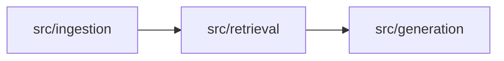

# 개발 환경 가이드

README의 실행 방법을 보완하는 상세 문서. 개발 환경, 코드 포맷, CI, PR 자동화의 동작과 설정 방법을 정리한다.

## Docker 개발 환경

| 파일 | 역할 |
|---|---|
| `Dockerfile` | `base`(실행 의존성) → `dev`(black·pytest·pre-commit·git, 비루트 사용자 `app`) 2단계 이미지 |
| `compose.yaml` | `app` 개발 컨테이너. 저장소를 `/app`에 마운트하고 `.env`가 있으면 환경변수로 읽는다 |
| `.dockerignore` | `.env`, `data/`, `reports/` 등을 빌드 컨텍스트에서 제외 |
| `Makefile` | `make up`, `make test`, `make format` 등 공용 명령 |

- 벡터 저장소는 로컬 Chroma(`data/patents/chroma/`)를 사용하며 별도 DB 컨테이너는 두지 않는다.
- 컨테이너 사용자는 UID 1000이다. Linux에서 호스트 UID가 다르면 `docker compose build --build-arg APP_UID=$(id -u) --build-arg APP_GID=$(id -g) app`으로 다시 빌드한다.
- Windows에서 `make`가 없으면 README의 `docker compose` 명령을 직접 실행한다.

## 코드 포맷 (black)

```bash
make format         # docker compose run --rm app black .
make format-check   # CI와 같은 검사
```

- 설정은 `pyproject.toml`의 `[tool.black]`에 있다(줄 길이 88, Python 3.12 대상).
- black 버전은 `requirements-dev.txt`와 `.pre-commit-config.yaml` 두 곳에 같은 값으로 고정한다. 버전을 올릴 때는 두 파일을 함께 수정한다.
- `required-version = "26"`이므로 다른 주 버전의 black은 실행이 거부된다. black은 매년 1월 주 버전에서만 안정 스타일을 바꾸므로, 주 버전을 올릴 때는 `required-version`도 함께 바꾸고 전체 포맷을 한 번에 적용한다.
- VS Code는 `.vscode/settings.json`에 따라 저장 시 black을 적용한다. 권장 확장은 `.vscode/extensions.json`에 있다.

## pre-commit

```bash
pip install -r requirements-dev.txt   # 호스트 가상환경 기준
pre-commit install                    # 커밋 시 자동 검사 등록
pre-commit run --all-files            # 전체 파일 검사 (make precommit)
```

검사 항목: black, 병합 충돌 표시, YAML·TOML 문법, 1MB 초과 파일, 개인키, 파일 끝 개행, 줄끝 공백.

## CI (`.github/workflows/ci.yml`)

| job | 내용 |
|---|---|
| `format` | `requirements-dev.txt`에 고정된 black으로 `black --check --diff .` |
| `test` | `python -m pytest`. 수집된 테스트가 없으면(종료 코드 5) 통과 처리 |
| `scripts` | `node --test "scripts/**/*.test.mjs"` — Notion·리뷰어 자동화 테스트 |
| `docker` | `docker compose config` 검증과 `app` 이미지 빌드 |

## PR 리뷰어 자동 지정 (`.github/workflows/assign-reviewer.yml`)

- PR이 열리거나 초안에서 전환되거나 리뷰 요청이 해제되어 **리뷰어가 0명**이 되면, 작성자를 제외한 후보 중 한 명을 무작위로 지정한다.
- 이미 리뷰어가 요청되어 있거나 작성자 외 리뷰가 있으면 변경하지 않는다.
- 후보 기본값은 저장소 협업자 GitHub ID 목록이며, 저장소 **Settings → Secrets and variables → Actions → Variables**에 `REVIEWER_POOL`(쉼표 구분)을 만들면 그 값을 우선한다.
- 후보 전원에게 요청이 실패하면 job이 실패로 표시된다.
- `pull_request_target`으로 실행되며 PR 코드가 아닌 base 브랜치의 `scripts/github/`만 체크아웃한다.

## Notion PR 문서화 (`.github/workflows/notion-pr-documentation.yml`)

develop에 병합된 PR마다 Notion의 `GitHub PR 자동 문서화` 페이지 아래에 기록한다. 같은 제목의 기록이 있으면 새로 만들지 않는다.

### 페이지 구성

1. 요약 callout: PR 번호·작성자·브랜치·병합 시각(KST)·변경 규모
2. PR 정보: PR·작성자·병합 커밋·자동화 실행 링크
3. PR 설명: 본문 마크다운을 Notion 블록(제목·목록·체크박스·표·인용·코드·mermaid)으로 변환
4. PR 설명 원문: 토글 안의 markdown 코드 블록
5. 커밋·변경 파일: 코드 블록
6. 변경 구조 다이어그램: 변경 파일 경로·상태로 만든 mermaid
7. 서비스 연결 구조: `docs/architecture.md` 다이어그램에서 변경 모듈을 강조한 mermaid
8. 문서화 검토 후보와 해석 범위

### PR 설명에 다이어그램 넣기

PR 설명에 mermaid 코드 블록을 쓰면 GitHub와 Notion 페이지에 모두 기록된다.

````markdown

````

- HTML 주석(`<!-- -->`) 안에는 mermaid 화살표 `-->`를 쓰지 않는다. 주석이 그 위치에서 끝난다.

### 서비스 연결 다이어그램 강조 규칙

- `docs/architecture.md`의 mermaid 다이어그램에 있는 `%% map <경로> <노드ID>` 주석으로 변경 파일과 노드를 연결한다.
- `/`로 끝나는 경로는 하위 파일 전체, 그 외에는 해당 파일(또는 같은 이름의 디렉터리)과 일치한다.
- 새 모듈을 추가하면 다이어그램 노드와 `%% map` 줄을 함께 추가한다.

### 미리보기와 수동 실행

```bash
make notion-preview PR=5                       # Notion을 호출하지 않고 페이지 구성을 JSON으로 출력
NOTION_DRY_RUN=1 NOTION_DRY_RUN_OUTPUT=preview.json PR_NUMBER=5 \
  GITHUB_REPOSITORY=<owner>/<repo> node scripts/create_notion_pr_page.mjs
```

- 미리보기는 병합 전 PR에도 사용할 수 있다. `gh` CLI 로그인 상태면 그 토큰으로 GitHub API를 호출한다.
- 실제 기록은 저장소 **Actions → Notion PR Documentation → Run workflow**에서 병합된 PR 번호로 실행할 수 있다.
- 워크플로는 항상 `develop`의 스크립트를 사용하므로, 스크립트 변경은 develop 병합 후에 반영된다.

### 제약

- Notion API 요청 제한(rich text 2000자, 배열 100개, 중첩 2단계, 요청당 1000블록·500KB)에 맞춰 블록을 나누어 추가한다. 추가 중 실패하면 미완성 페이지를 휴지통으로 옮기므로 다시 실행할 수 있다.
- Notion API에는 mermaid 코드 블록의 표시 방식(코드·미리보기)을 지정하는 필드가 없다. 다이어그램이 코드로 보이면 Notion에서 블록의 표시 방식을 미리보기로 바꾼다.

### 설정

1. Notion 내부 연결을 `GitHub PR 자동 문서화` 페이지에만 공유한다.
2. Notion API 토큰을 저장소 **Settings → Secrets and variables → Actions → New repository secret**에서 `NOTION_API_TOKEN` 이름으로 저장한다.
3. Notion 연결에 읽기와 삽입 권한이 켜져 있는지 확인한다.

토큰을 채팅, 코드, README 또는 커밋에 넣지 않는다.

## Dependabot (`.github/dependabot.yml`)

pip, pre-commit, GitHub Actions 버전 갱신 PR을 생태계별로 묶어 월 1회 develop(기본 브랜치)에 만든다.
