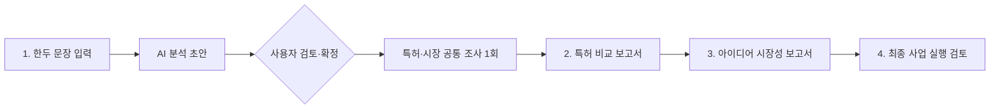

# 아이디어 사업 검토 흐름

## 목적과 판단 범위

사용자가 한두 문장으로 시작해도 분석에 쓸 아이디어 초안을 만들고, 실제 특허 문헌 및 시장 근거와 대조한 뒤 다음 사업 검증 행동을 결정할 수 있게 한다. 보고서는 증거·사용자 입력·AI 가설·미확인을 구분하며, 근거가 부족한 경우 결론을 억지로 완성하지 않는다.

최종 권고는 사업 성공 예측이나 투자 권유가 아니다. `진행 검증`, `제한된 파일럿`, `추가 조사 후 판단`, `보류·재설계` 중 다음에 할 검증 행동을 권한다. 특허 분석은 공개 문헌의 예비 비교이며 등록 가능성, 침해, 자유실시를 법적으로 판정하지 않는다.

## 사용자 흐름



단계 2와 3은 같은 확정 입력과 한 번의 공통 조사 실행 결과를 순서대로 보여주며 독립적인 오류·상태를 가진다. 한 영역이 실패해도 다른 영역의 근거는 보존한다. 사용자가 확정 입력이나 기술 분야를 바꾸면 그 입력에 의존하는 분석 결과와 최종 보고서를 무효화한다. 메모나 비용 표의 수정은 조사 결과를 무효화하지 않는다.

## 단계 1: 입력을 분석용 초안으로 구체화

### 입력과 생성 결과

짧거나 불완전한 아이디어도 파서가 초안을 생성한다. 초안은 아래 항목을 갖는다.

| 항목 | 용도 | 근거 구분 |
|---|---|---|
| 아이디어 제목 | 보고서 식별 | 입력에서 추출 또는 AI 정리 |
| 문제·현재 대안 | 고객 문제와 현재 해결 방식 | 입력 사실 또는 미확인 |
| 기술·기술 구성요소 | 특허 검색과 구성 비교 | 입력 사실 또는 AI 정리 |
| 목표 고객·사용 환경·목표 세그먼트 | 시장 검색과 고객 가설 | 입력 사실 또는 미확인 |
| 차별점 | 대안 대비 차이 가설 | 입력 사실 또는 사용자 가설 |
| 가치 가설·측정 변수 | 고객 가치 및 ROI 검증 설계 | AI 가설 또는 사용자 입력 |
| 수익모델·가격 가설 | 가격·경제성 검토 | 입력 사실, 사용자 가설 또는 미확인 |
| 미확인 항목·추가 질문 | 추가 입력이 필요한 이유 | 코드에서 관리 |

기존 `IdeaDraft`의 필드별 출처 표기를 확장한다. 출처는 `extracted`, `user_answer`, `ai_hypothesis`, `unknown` 중 하나다. 파서는 아이디어에서 직접 읽을 수 없는 고객 수, 성능 수치, 가격, 시장 규모를 사실 필드로 채우지 않는다. AI가 유용한 가설을 제안할 때는 사실 필드와 분리한다.

### 확인과 진행

사용자는 구조화된 초안, 기술 구성요소, 가설을 확인·수정한다. AI 질문은 특허 검색이나 시장성 판단을 크게 바꿀 핵심 공백에 한정한다. 답변하지 않거나 `모름`을 선택해도 해당 값을 `unknown`으로 두고 진행할 수 있다. 분석 시작 전에 확정된 입력의 스냅샷을 만들고 모든 보고서에 동일한 스냅샷 ID를 기록한다.

## 단계 2: 특허 비교 및 등록 관련 예비 검토

### 후보 선택과 문헌 정제

검색은 기술 구성요소별 쿼리를 만들고 검색 분야, 원천 색인, KIPRIS 보충 여부, 검색 시점을 기록한다. 관련성 판정은 기술 분야의 단순 일치가 아니라 구체적 구성과 해결 방식의 대응을 요구한다.

청구항 정제 단계에서 빈 문구, `삭제` 표시 청구항, 중복 번호·내용을 제외한다. 독립항과 종속항을 구분하고 종속항은 참조하는 상위항 원문을 같이 제공한다. 상위항을 확보하지 못하면 종속항만으로 범위를 추정하지 않고 미확인으로 둔다. 초록만 확보된 문헌은 청구항 비교 결과가 아닌 기술 분야 참고로 표시한다.

### 보고서 데이터 계약

특허는 문헌별로 한 번씩 묶고, 청구항·근거 인용은 문헌 아래에 둔다.

```text
PatentReview
  patent_id, title, application/publication/registration numbers and dates
  source_url, source_type, search_scope
  relevance: high | medium | low | insufficient
  relevance_reason
  claim_evidence[]: citation_id, claim_number, claim_type, depends_on, quote, version
  component_comparisons[]:
    component_id, idea_component, status, citation_ids,
    overlap, difference, uncertainty
  overall_summary, watchouts[], unknowns[]

PatentabilityPrecheck
  status: notable_overlap | potentially_distinct | insufficient_evidence
  observations[]: statement, citation_ids
  distinction_hypotheses[]
  questions_for_patent_professional[]
  scope_limitations[]
```

모든 비교는 실제 제공 청구항 인용 ID에 연결한다. 공통점·차이점에는 대응하는 아이디어 구성요소와 청구항 번호를 표시한다. `overlap_concern`은 유사 문헌 조사에서 주의할 신호이지 등록 불가나 침해 판정이 아니다. `potentially_distinct`도 등록 가능성을 보장하지 않는다. 신규성·진보성 검토에는 검색 누락, 출원일 전 공개 여부, 특허 패밀리, 법적 상태와 전문가 검토가 필요하다고 명시한다.

## 단계 3: 아이디어 중심 시장성 분석

기존 다섯 차원(수요, 경쟁·대체재, 가격, 구매자, 도입장벽)을 유지하면서 각 문장을 확정 아이디어의 고객·문제·대안과 연결한다.

| 검토 주제 | 답할 질문 |
|---|---|
| 고객과 사용 환경 | 누가 사용하고 누가 구매를 결정하는가? 어떤 공정·지역·기업 규모인가? |
| 문제와 대안 | 현재 어떤 방식으로 해결하며 문제 빈도·비용·품질 영향은 무엇인가? |
| 수요와 구매 | 실제 도입·구매 검토·예산·조달 근거가 있는가? 산업 신호와 고객 확인을 구분했는가? |
| 경쟁과 대체재 | 같은 문제를 푸는 제품·서비스·수작업 대안은 무엇인가? |
| 가격과 고객 가치 | 가격·과금 방식·비용 절감 근거가 있는가? ROI 계산에 필요한 값은 무엇인가? |
| 도입 장벽 | 통합·운영·안전·보안·인력·규제·예산 문제가 있는가? |
| 다음 검증 | 어떤 고객을 대상으로 어떤 질문·견적·파일럿을 수행하고 무엇을 성공 기준으로 삼는가? |

현재 UI는 공개 산업 자료·기업 주장·조달·공공 자료를 분석하며, `MarketEvidence` 계약은 `customer_validation` 유형도 표현할 수 있다. 그러나 이번 구현은 인터뷰·견적·파일럿 원자료를 UI에서 입력·업로드하지 않는다. 그런 자료는 후속 동의·개인정보 보호 설계를 추가하기 전에는 분석 경로에 포함하지 않는다. 공개 뉴스나 기업 홍보는 특정 고객의 구매 의사 증거로 바꾸지 않는다. 직접 고객 검증 자료가 없으면 수요를 미검증으로 표시한다. TAM/SAM/SOM, 가격, 매출, ROI는 출처와 산식이 없으면 산출하지 않는다. 입력 가정으로 계산한 값은 사실이 아닌 시나리오로 표시한다.

시장 결과는 목표 세그먼트, 문제·대안, 다섯 차원의 주장과 인용, 근거 유형·신뢰 한계, 가치 계산 변수, 핵심 가정, 다음 인터뷰·견적·실증 계획을 포함한다. 실행 권고용 준비도는 단일 점수가 아니라 `고객 문제`, `직접 수요`, `차별성`, `경제성`, `도입 가능성`별 `근거 있음`·`신호만 있음`·`미검증` 상태로 제공한다.

## 단계 4: 최종 사업 실행 검토

특허와 시장 보고서를 단순 병합하지 않고, 아이디어의 기술 차별점이 고객 문제에 가치가 있는지 근거 ID로 연결해 본다. 특허 위험과 시장 기회가 상충하면 두 근거를 나란히 표시한다.

최종 보고서 첫 화면에는 아래를 제공한다.

- 다음 행동 권고: `진행 검증`·`제한된 파일럿`·`추가 조사 후 판단`·`보류·재설계`
- 권고 근거 최대 3개와 가장 큰 기회·위험
- 판단 신뢰 수준과 결론에 가장 큰 영향을 주는 미확인 사항
- 다음 2~4주의 구체 행동, 대상, 측정 기준, 진행·중단 조건

판단은 차원별 증거와 명시적 규칙으로 설명한다. 가중치 없는 합산 점수나 근거 없는 확률을 쓰지 않는다. 예를 들어 직접 고객 증거가 없거나 주요 특허 청구항 비교가 부족하면 전체 권고는 원칙적으로 `추가 조사 후 판단` 이하로 제한한다. 이 권고는 투자·법률 자문이나 사업 성공 보장이 아니다.

최종 보고서는 ① 실행 권고 ② 아이디어·고객 요약 ③ 특허 비교·예비 검토 ④ 시장성 ⑤ 기회·위험 통합 ⑥ 핵심 가정·미확인 ⑦ 다음 검증과 통과 기준 ⑧ 인용 근거 ⑨ 범위·한계를 포함한다.

## UI 상태와 오류 처리

UI 단계는 `아이디어 입력·초안 확인 → 특허 비교 보고서 → 시장성 보고서 → 최종 실행 검토`다. 특허·시장 조사는 한 번 실행해 각각의 보고서로 보여 주며, 한쪽 오류가 다른 쪽 근거를 지우지 않는다. 특허 문헌의 상세 청구항, 시장 기사 원문은 기본 요약에서 분리해 펼쳐 본다.

각 결과에는 상태, 검색 범위, 근거 수, 데이터 기준일, 오류·미확인을 표시한다. 최종 검토에는 특허·시장 원본 보고서를 바꾸지 않는 읽기 전용 영역 요약(`domain`, 상태, 실제 확인 내용, 근거 ID, 근거 범위, 한계, 다음 확인)을 함께 제공한다. 각 영역 요약과 통합 판단을 구분하고, 어느 한쪽이 실패·미실행·시간 초과이면 그 상태를 그대로 표시한다. 근거가 확보된 실패 영역은 해당 근거와 오류를 함께 반환한다. 비밀 키는 오류와 보고서에서 마스킹한다. 원문·사용자 입력은 Markdown 렌더링을 escape한다. OpenAI API로 전송되는 사용자 제공 자료의 범위와 호출이 발생하는 시점을 화면에 알린다.

입력 스냅샷에 `idea_revision`과 `analysis_key`를 둔다. 구조화 필드·구성·기술 분야가 바뀌면 특허·시장 결과를 무효화한다. 고객 검증 메모 입력은 현재 미지원이다. 후속으로 지원할 때는 익명 요약만 받고 외부 전송 여부를 별도 선택하게 하며, 자료도 analysis key에 포함해 삭제·수정 시 시장 및 최종 결과를 무효화한다.

## 구현 경계와 순서

1. 계약·파서: `src/schemas.py`, `src/generation/idea_parser.py`, `prompts/idea_parser.md`, 입력 UI.
2. 특허: `src/ingestion/patent_processor.py` 삭제 청구항 정제, `src/services/patent_service.py` 문헌 그룹화, `src/generation/patent_analysis.py` 및 `prompts/patent_analysis.md` 구성요소 대조, 특허 UI.
3. 시장: `src/retrieval/market_search.py` 아이디어별 질문 확장, 시장 분석 계약·프롬프트, 고객 검증 자료 경계, 시장 UI.
4. 통합: `src/generation/business_review.py` 실행 권고 규칙, `src/pipeline.py`, `src/generation/report_builder.py`, 최종 보고서 UI.
5. `docs/api_contract.md`, `docs/architecture.md`, README, 단위·통합·UI 검증 절차를 같은 계약에 맞춘다.

검증은 스키마·파서 경계, 삭제/종속 청구항, 특허 구성요소 매핑과 근거 ID, 시장 claim 근거·수치 검증, 부분 실패 보존, 권고 규칙, Markdown escaping 및 네 단계 Streamlit 흐름을 확인한다. API 키·실제 외부 데이터가 필요한 실분석은 별도로 표시하고 사용자 승인 없는 비용 발생 호출을 하지 않는다.
