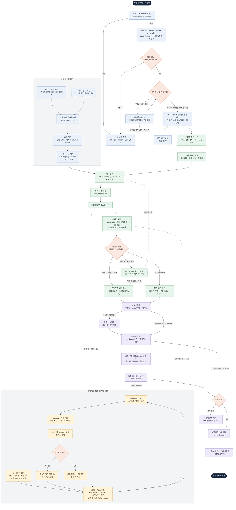

# 시장 조사 설계

아이디어 한 문장을 5개 항목으로 구조화한 뒤, 수요·경쟁/대체재·가격·구매자·도입장벽 5개 차원별로
시장 근거를 검색하고, 출처가 확인된 문장만으로 시장 분석 결과를 만든다.

## 처리 흐름

- 색: 파랑 = 입력·데이터 준비, 초록 = 검색, 보라 = 분석 생성·검증, 노랑 = 평가, 주황 = 판단 분기
- 점선 테두리: 아직 구현되지 않은 단계 / 점선 화살표: 선택 단계, 평가 연결, 다른 파트로의 인계
- 아이디어 5개 항목(`StructuredIdea`)은 특허 파트와 공통 입력이며, UI·보고서 통합(파트 1·4)은 시장 파트의 출력 경계다.
- 재시도 상한: 빈 항목 재질문 2회, 실시간 보충 후 재검색 1회, 인용 검증 실패 시 재생성 최대 2회.
- 재질문 후에도 비어 있는 항목은 모름으로 표시하고, 해당 항목에 기대는 차원은 미확인으로 판정한다(예: 수익모델 모름 → 가격 미확인).

## 아이디어 5개 항목

| 항목 | 필드 | 주로 쓰는 시장 차원 |
|---|---|---|
| 문제 | `problem` | 수요 |
| 기술 | `technology` | 전 차원 |
| 고객 | `customers` | 수요·구매자·도입장벽 |
| 차별점 | `difference` | 경쟁/대체재 |
| 수익모델 | `revenue` | 가격 |

## 충분성 판정

차원별 근거가 충분한지는 검색 거리가 아니라 LLM 관련성 판정으로 정한다.

- 거리로는 관련 기사를 구분할 수 없다. 평가 라벨 300건에서 관련/비관련을 거리로 나눈 AUC는 0.52(도입장벽 0.33)이고, 어떤 임계값을 써도 충분성 판정 정확도가 '항상 부족'으로 답할 때(64%)보다 높지 않았다.
- 상위 5건마다 `prompts/market_label_judge.md`(평가셋 라벨과 같은 기준)로 관련 여부와 이유를 판정하고, 관련 건수로 상태를 정한다.

| 상태 | 조건 |
|---|---|
| `sufficient` | 관련 근거 2건 이상 |
| `limited` | 관련 근거 1건 (신호 수준) |
| `insufficient` | 검색 결과는 있으나 관련 근거 없음 |
| `no_results` | 검색 결과 없음 |
| `error` | 판정 실패 (검색 결과는 판정 없이 반환) |

판정 모델은 사람 라벨 91건 기준으로 골랐다. 필터 없이 상위 5건을 쓰면 관련 비율(정밀도)은 0.54이다.

| 모델 | 정확도 | 정밀도 | 재현율 | kappa |
|---|---|---|---|---|
| `gpt-4o` | 0.76 | 0.89 | 0.63 | 0.52 |
| `gpt-4o-mini` (기본) | 0.68 | 0.69 | 0.73 | 0.36 |

- 비용 때문에 관련성 판정은 `gpt-4o-mini`를 쓴다. 아이디어 1건 실행에서 판정 25회가 전체 토큰의 약 90%를 차지해(입력 약 4.8만 토큰), `gpt-4o` 대비 비용이 약 1/16이다.
- 프로젝트 LLM은 비용 때문에 관련성 판정·분석 생성 모두 `gpt-4o-mini`를 쓴다. `gpt-4o-mini`는 정밀도가 낮아 비관련 기사가 근거로 더 많이 들어온다.
- 분석을 `gpt-4o-mini`로 생성하면 허용 범위 안에서 가장 강한 판정을 고르는 경향이 있다. 샘플 5건 모두 경쟁 차원이 근거가 약한 기사로 `confirmed`가 되어(SF-05 포함), 판정 제한을 코드 규칙으로 강화했다: 근거가 모두 사업 신호·기업 주장·추정치이면 어느 차원도 `confirmed`를 허용하지 않는다(뉴스만 있으면 최대 `signal_only`).
- 사람 라벨 중 사람·LLM 판정이 달랐던 행은 LLM 판정을 보고 확정했으므로, 두 모델 차이는 실제보다 크게 나타났을 수 있다.
- 사람 라벨만 있는 6문항에서 충분성 상태 일치는 `gpt-4o` 5/6, `gpt-4o-mini` 4/6이다. 문항 수가 적어 상태 정확도의 근거로는 부족하다.

## 입력 가드레일

아이디어 입력 단계에서 주제 이탈과 프롬프트 조작을 막는다. LLM 호출은 구조화와 같은 1회다.

1. **규칙 검사**(`src/generation/input_guard.py`, LLM 호출 전): 5자 미만·1,000자 초과, 지시 무시·시스템 프롬프트 공개·역할 변경 등 AI 자신을 겨냥한 표현. 작업 지침 안내·시스템 메시지 전송·안전장치 해제 감지처럼 정상 아이디어에 나오는 표현은 잡지 않도록 범위를 좁혔다.
2. **LLM 판정**(`prompts/idea_parser.md`): 구조화 응답에 `input_status`를 함께 받는다. `ok`(제조·스마트팩토리 사업 아이디어), `off_topic`(사업 아이디어가 아니거나 다른 분야), `unsafe`(지침 변경 시도, 불법·유해 목적). 사용자 문장은 `{"idea_text": ...}` JSON 값으로 넘겨 데이터로 다룬다.
3. `ok`가 아니면 `IdeaDraft.status="rejected"`와 사용자 안내(`rejection_reason`)를 반환하고, 검색 요청을 만들지 않는다. 재질문 답변도 규칙 검사(300자·조작 표현)를 거친다.
4. 검색된 기사에 지시처럼 보이는 문장이 있어도 따르지 않도록 관련성 판정·시장 분석 프롬프트에 데이터 취급 규칙을 둔다.

평가(`evaluation/guardrail_cases.json` 28문항 + 샘플 아이디어 5개, `gpt-4o-mini`):

| 구분 | 문항 | 결과 |
|---|---|---|
| 공격(조작 시도 9 · 유해 목적 3)·주제 이탈(10) | 22 | 모두 차단 (규칙 5 · LLM 17), off_topic·unsafe 구분도 일치 |
| 정상(샘플 5 · 일반 2 · 오탐 유도 4) | 11 | 오차단 0 |

- 문항은 프롬프트 작성자가 만든 것이라 실제 공격보다 쉬울 수 있다. 새로운 우회 표현은 문항에 추가해 회귀 평가한다.

## 시장 분석 생성

관련 판정된 기사만 인용 근거(`MarketEvidence`)로 만들고, 차원별 판정과 문장을 LLM(`gpt-4o-mini`, `prompts/market_analysis.md`)으로 생성한 뒤 코드로 검증한다. 결과는 `MarketReport` JSON이다.

- 같은 기사가 여러 차원에 나오면 `citation_id` 하나를 공유한다. 인용문(`quote`)은 기사 요약이다.
- 최신성(`recency`)은 기준일까지 1년 이내 high, 3년 이내 medium, 그 밖 low이다. 직접성(`directness`)은 구매·지불 근거면 high, 관련성 판정 확신이 높으면 medium, 그 밖 low이다.
- 충분성 상태로 쓸 수 있는 판정을 미리 제한해 프롬프트에 넘긴다.

| 충분성 상태 | 허용 판정 |
|---|---|
| `sufficient` | 확인됨 · 신호만 확인 · 미확인 ('확인됨'은 사업 신호·기업 주장·추정치가 아닌 근거가 있을 때만, 수요는 고객 검증 자료(`direct_demand`)가 있을 때만) |
| `limited` | 신호만 확인 · 미확인 |
| `insufficient` · `no_results` · `error` | 미확인 |
| 기대는 아이디어 항목이 모름 (가격 ← 수익모델, 구매자 ← 고객) | 미확인 (근거 문장은 쓸 수 있음, 검증 과제는 그 항목을 정하는 일부터) |

- 검증 항목: 허용 판정인지, 차원당 문장 3개 이하인지, 사실 문장(`fact`)에 이 차원 근거의 인용이 있는지, 문장의 숫자가 인용 기사(제목·요약·발행일)나 아이디어 입력에 있는지, 사실 문장의 단위 붙은 수치(%·원·억·건·대 등)에 4자리 기준 연도가 있는지, 확인됨·신호만 확인에 인용된 사실 문장이 있는지, 미확인에 검증 과제가 있는지.
- 검증에 실패하면 오류 내용을 넘겨 최대 2회 재생성한다. 그래도 실패한 문장은 제거하고, 판정을 유지할 수 없으면 미확인과 기본 검증 과제로 바꾼다.
- 문장이 기사 내용을 정확히 옮겼는지(원문 일치)는 코드로 검증하지 않으며, 평가 단계(Citation Accuracy)에서 확인한다.
- 수집 뉴스는 모두 사업 신호(`business_signal`)이므로, 뉴스만으로는 어느 차원도 '확인됨'이 되지 않는다.

## 단계별 코드 위치

| 단계 | 위치 |
|---|---|
| 아이디어 구조화·재질문 | `prompts/idea_parser.md`, `src/generation/idea_parser.py` |
| 입력 가드레일 | `src/generation/input_guard.py`, `prompts/idea_parser.md`, `evaluation/guardrail_cases.json`, `evaluation/guardrail_eval.py` |
| 공통 기술 분야·시장/특허 키워드·시장 수집 설정 | `configs/technology_areas.yaml` |
| 네이버 뉴스 수집 | `src/ingestion/news_client.py` → `data/market/raw/` |
| DART 공시 수집 | `src/ingestion/dart_client.py` |
| 정제·중복 제거 | `src/ingestion/market_processor.py` → `data/market/processed/market_docs.jsonl` |
| 색인·차원별 검색 툴 | `src/retrieval/market_search.py` → `data/market/chroma/` |
| 관련성 판정·충분성 상태 | `src/retrieval/market_relevance.py`, `prompts/market_label_judge.md` |
| 시장 조사 진입점 | `src/services/market_service.py` |
| 보고서용 마크다운 섹션 | `src/generation/market_markdown.py` |
| 연결 계약 (입력·출력·오류) | `docs/api_contract.md` |
| 시장 분석 생성 규칙 | `prompts/market_analysis.md`, `src/generation/market_analysis.py` |
| 데이터 형식·결과 계약 | `src/schemas.py` (`MarketDocument`, `MarketSearchRequest`, `MarketReport`) |
| 평가 문항·정답 라벨 | `evaluation/market_cases.json`, `evaluation/labels/`, `evaluation/market_labeling.py`, `evaluation/market_judge.py` |
| 검색·관련성 판정 평가 실행·결과 | `evaluation/evaluate.py`, `evaluation/market_relevance_eval.py` → `evaluation/results/` |

## 공통 검색 엔진

특허·시장 검색은 기존 Dense 검색을 기본값으로 유지하며, 호출에서 `retrieval_mode="bm25"` 또는 `"hybrid"`를 선택할 수 있다. Hybrid는 dense·BM25 순위를 RRF로 결합한다. 특허 결과는 `source_id` 기준으로 한 문헌을 한 번만 반환하고, 시장은 기존 `dup_group` 정책을 적용한다. 메타데이터 동등 조건, 후보 수, 최종 Top-K, RRF 상수와 reranker 콜백은 공통 `RetrievalConfig`/검색 인터페이스에서 지정한다.

`python -m evaluation.evaluate market --mode dense|bm25|hybrid`는 기존 25개 시장 라벨로 Hit@K·Recall@K·Precision@K·MRR·nDCG@K와 검색 지연을 기록한다. `--rerank`는 선택 설치한 `sentence-transformers`와 `BAAI/bge-reranker-v2-m3`를 사용하며, 설치되지 않은 Cross-Encoder의 품질·속도는 검증된 것으로 간주하지 않는다. 시장 처리 원문·색인이 로컬에 준비되지 않은 경우 평가를 실행하지 않는다. 특허 평가셋 및 원문 데이터가 준비되기 전에는 특허 품질 개선 수치를 보고하지 않는다.

### 시장 검색 방식 비교

비교 전에 dense·bm25·hybrid 상위 5건 중 라벨 후보에 없던 문서 123건(bm25 105·hybrid 32, 중복 14)을 후보에 추가해 판정했다(`market_labeling extend`, gpt-4o 초안 + 확신 낮은 9건 사람 검토). 세 방식 모두 상위 5건에 미판단 문서가 없다(unjudged 0). 정답 문서가 늘어 dense의 Recall@5는 기존 baseline(0.45)보다 낮게 나온다.

| 방식 (25문항) | Hit@5 | Recall@5 | Precision@5 | MRR | nDCG@5 | 응답 시간 |
|---|---|---|---|---|---|---|
| dense (기본) | 0.96 | 0.37 | 0.43 | 0.59 | 0.45 | 350ms |
| bm25 | 0.60 | 0.18 | 0.30 | 0.43 | 0.31 | 96ms |
| hybrid | 0.80 | 0.31 | 0.46 | 0.61 | 0.48 | 296ms |

| 차원별 MRR / Recall@5 | dense | bm25 | hybrid |
|---|---|---|---|
| 수요 | 0.77 / 0.26 | 0.90 / 0.39 | 0.90 / 0.42 |
| 경쟁·대체재 | 0.77 / 0.34 | 0.70 / 0.35 | 0.84 / 0.37 |
| 가격 | 0.65 / 0.50 | 0.20 / 0.05 | 0.30 / 0.21 |
| 구매자 | 0.48 / 0.37 | 0.33 / 0.14 | 0.59 / 0.40 |
| 도입장벽 | 0.29 / 0.37 | 0.00 / 0.00 | 0.40 / 0.18 |

- BM25는 기술 용어(협동로봇·머신비전·예지보전)가 맞는 기사를 찾지만, 차원 표현(가격·비용·어려움·부담)은 흔한 단어라 가중치가 낮아 가격·도입장벽 차원과 관계없는 기사를 올린다.
- hybrid는 수요·경쟁·구매자에서 dense보다 높고, 가격·도입장벽에서 낮다. 차원 전체 평균으로는 어느 한쪽이 모두 앞서지 않는다.
- 결과: `evaluation/results/market_retrieval_{dense,bm25,hybrid}_extended.csv`. 추가 후보의 라벨은 대부분 LLM 판정이라, 사람 라벨 비중이 높은 기존 dense 후보와 라벨 출처 구성이 다르다.

SF-05 라벨은 이전 아이디어(현장 작업자용 LLM 음성 어시스턴트) 기준이라 현재 SF-05(지능형 공정제어)와 맞지 않는다. 같은 라벨로 SF-01~SF-04 20문항만 다시 계산하면 hybrid의 전체 우위가 사라진다.

| 방식 (20문항, SF-01~04) | Hit@5 | Recall@5 | Precision@5 | MRR | nDCG@5 |
|---|---|---|---|---|---|
| dense (기본) | 0.95 | 0.38 | 0.46 | 0.60 | 0.47 |
| bm25 | 0.60 | 0.18 | 0.32 | 0.41 | 0.32 |
| hybrid | 0.80 | 0.29 | 0.45 | 0.58 | 0.46 |

- hybrid는 수요(MRR 0.71 → 0.88)에서만 뚜렷하게 높고, 가격(0.69 → 0.38)·도입장벽(Hit@5 0.75 → 0.50)에서 낮다. 검색 기본값은 dense를 유지한다.
- 결과: `evaluation/results/market_retrieval_{dense,bm25,hybrid}_extended20.csv`
