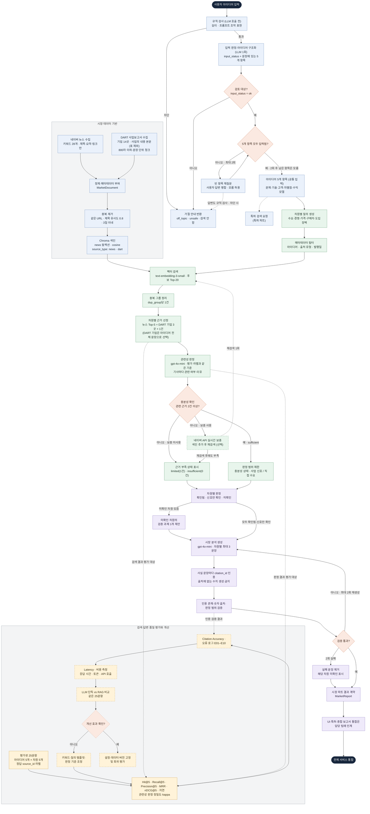

# 시장 조사 설계

아이디어 한 문장을 5개 항목으로 구조화한 뒤, 수요·경쟁/대체재·가격·구매자·도입장벽 5개 차원별로
시장 근거를 검색하고, 출처가 확인된 문장만으로 시장 분석 결과를 만든다.

## 처리 흐름

- 색: 파랑 = 입력·데이터 준비, 초록 = 검색, 보라 = 분석 생성·검증, 노랑 = 평가, 주황 = 판단 분기
- 점선 테두리: 아직 구현되지 않은 단계 / 점선 화살표: 선택 단계, 평가 연결, 다른 파트로의 인계
- 아이디어 5개 항목(`StructuredIdea`)은 특허 파트와 공통 입력이며, UI·보고서 통합(파트 1·4)은 시장 파트의 출력 경계다.
- 재시도 상한: 빈 항목 재질문 2회, 실시간 보충 후 재검색 1회, 인용 검증 실패 시 재생성 최대 2회.
- 재질문 후에도 비어 있는 항목은 모름으로 표시하고, 해당 항목에 기대는 차원은 미확인으로 판정한다(예: 수익모델 모름 → 가격 미확인).

## 아이디어 5개 항목

| 항목 | 필드 | 주로 쓰는 시장 차원 |
|---|---|---|
| 문제 | `problem` | 수요 |
| 기술 | `technology` | 전 차원 |
| 고객 | `customers` | 수요·구매자·도입장벽 |
| 차별점 | `difference` | 경쟁/대체재 |
| 수익모델 | `revenue` | 가격 |

## 충분성 판정

차원별 근거가 충분한지는 검색 거리가 아니라 LLM 관련성 판정으로 정한다.

- 거리로는 관련 기사를 구분할 수 없다. 평가 라벨 300건에서 관련/비관련을 거리로 나눈 AUC는 0.52(도입장벽 0.33)이고, 어떤 임계값을 써도 충분성 판정 정확도가 '항상 부족'으로 답할 때(64%)보다 높지 않았다.
- 상위 5건마다 `prompts/market_label_judge.md`(평가셋 라벨과 같은 기준)로 관련 여부와 이유를 판정하고, 관련 건수로 상태를 정한다.

| 상태 | 조건 |
|---|---|
| `sufficient` | 관련 근거 2건 이상 |
| `limited` | 관련 근거 1건 (신호 수준) |
| `insufficient` | 검색 결과는 있으나 관련 근거 없음 |
| `no_results` | 검색 결과 없음 |
| `error` | 판정 실패 (검색 결과는 판정 없이 반환) |

판정 모델은 사람 라벨 91건 기준으로 골랐다. 필터 없이 상위 5건을 쓰면 관련 비율(정밀도)은 0.54이다.

| 모델 | 정확도 | 정밀도 | 재현율 | kappa |
|---|---|---|---|---|
| `gpt-4o` | 0.76 | 0.89 | 0.63 | 0.52 |
| `gpt-4o-mini` (기본) | 0.68 | 0.69 | 0.73 | 0.36 |

- 비용 때문에 관련성 판정은 `gpt-4o-mini`를 쓴다. 아이디어 1건 실행에서 판정 25회가 전체 토큰의 약 90%를 차지해(입력 약 4.8만 토큰), `gpt-4o` 대비 비용이 약 1/16이다.
- 프로젝트 LLM은 비용 때문에 관련성 판정·분석 생성 모두 `gpt-4o-mini`를 쓴다. `gpt-4o-mini`는 정밀도가 낮아 비관련 기사가 근거로 더 많이 들어온다.
- 분석을 `gpt-4o-mini`로 생성하면 허용 범위 안에서 가장 강한 판정을 고르는 경향이 있다. 샘플 5건 모두 경쟁 차원이 근거가 약한 기사로 `confirmed`가 되어(SF-05 포함), 판정 제한을 코드 규칙으로 강화했다: 근거가 모두 사업 신호·기업 주장·추정치이면 어느 차원도 `confirmed`를 허용하지 않는다(아래 "뉴스 근거 성격").
- 사람 라벨 중 사람·LLM 판정이 달랐던 행은 LLM 판정을 보고 확정했으므로, 두 모델 차이는 실제보다 크게 나타났을 수 있다.
- 사람 라벨만 있는 6문항에서 충분성 상태 일치는 `gpt-4o` 5/6, `gpt-4o-mini` 4/6이다. 문항 수가 적어 상태 정확도의 근거로는 부족하다.

## 입력 가드레일

아이디어 입력 단계에서 주제 이탈과 프롬프트 조작을 막는다. LLM 호출은 구조화와 같은 1회다.

1. **규칙 검사**(`src/generation/input_guard.py`, LLM 호출 전): 5자 미만·1,000자 초과, 지시 무시·시스템 프롬프트 공개·역할 변경 등 AI 자신을 겨냥한 표현. 작업 지침 안내·시스템 메시지 전송·안전장치 해제 감지처럼 정상 아이디어에 나오는 표현은 잡지 않도록 범위를 좁혔다.
2. **LLM 판정**(`prompts/idea_parser.md`): 구조화 응답에 `input_status`를 함께 받는다. `ok`(제조·스마트팩토리 사업 아이디어), `off_topic`(사업 아이디어가 아니거나 다른 분야), `unsafe`(지침 변경 시도, 불법·유해 목적). 사용자 문장은 `{"idea_text": ...}` JSON 값으로 넘겨 데이터로 다룬다.
3. `ok`가 아니면 `IdeaDraft.status="rejected"`와 사용자 안내(`rejection_reason`)를 반환하고, 검색 요청을 만들지 않는다. 재질문 답변도 규칙 검사(300자·조작 표현)를 거친다.
4. 검색된 기사에 지시처럼 보이는 문장이 있어도 따르지 않도록 관련성 판정·시장 분석 프롬프트에 데이터 취급 규칙을 둔다.

평가(`evaluation/guardrail_cases.json` 28문항 + 샘플 아이디어 5개, `gpt-4o-mini`):

| 구분 | 문항 | 결과 |
|---|---|---|
| 공격(조작 시도 9 · 유해 목적 3)·주제 이탈(10) | 22 | 모두 차단 (규칙 5 · LLM 17), off_topic·unsafe 구분도 일치 |
| 정상(샘플 5 · 일반 2 · 오탐 유도 4) | 11 | 오차단 0 |

- 문항은 프롬프트 작성자가 만든 것이라 실제 공격보다 쉬울 수 있다. 새로운 우회 표현은 문항에 추가해 회귀 평가한다.

## 시장 분석 생성

관련 판정된 기사만 인용 근거(`MarketEvidence`)로 만들고, 차원별 판정과 문장을 LLM(`gpt-4o-mini`, `prompts/market_analysis.md`)으로 생성한 뒤 코드로 검증한다. 결과는 `MarketReport` JSON이다.

- 같은 기사가 여러 차원에 나오면 `citation_id` 하나를 공유한다. 인용문(`quote`)은 기사 요약이다.
- 최신성(`recency`)은 기준일까지 1년 이내 high, 3년 이내 medium, 그 밖 low이다. 직접성(`directness`)은 구매·지불 근거면 high, 관련성 판정 확신이 높으면 medium, 그 밖 low이다.
- 충분성 상태로 쓸 수 있는 판정을 미리 제한해 프롬프트에 넘긴다.

| 충분성 상태 | 허용 판정 |
|---|---|
| `sufficient` | 확인됨 · 신호만 확인 · 미확인 ('확인됨'은 사업 신호·기업 주장·추정치가 아닌 근거를 인용한 사실 문장이 있을 때만, 수요는 고객 검증 자료(`direct_demand`)가 있을 때만) |
| `limited` | 신호만 확인 · 미확인 |
| `insufficient` · `no_results` · `error` | 미확인 |
| 기대는 아이디어 항목이 모름 (가격 ← 수익모델, 구매자 ← 고객) | 미확인 (근거 문장은 쓸 수 있음, 검증 과제는 그 항목을 정하는 일부터) |

- 검증 항목: 허용 판정인지, 차원당 문장 3개 이하인지, 사실 문장(`fact`)에 이 차원 근거의 인용이 있는지, 문장의 숫자가 인용 기사(제목·요약·발행일)나 아이디어 입력에 있는지, 사실 문장의 단위 붙은 수치(%·원·억·건·대 등)에 4자리 기준 연도가 있는지, 확인됨·신호만 확인에 인용된 사실 문장이 있는지, 미확인에 검증 과제가 있는지.
- 검증에 실패하면 오류 내용을 넘겨 최대 2회 재생성한다. 그래도 실패한 문장은 제거하고, 판정을 유지할 수 없으면 미확인과 기본 검증 과제로 바꾼다.
- 문장이 기사 내용을 정확히 옮겼는지(원문 일치)는 코드로 검증하지 않으며, 평가 단계(Citation Accuracy)에서 확인한다.
- 사용자 주장·AI 가설 문장에 "확인되었다"·"입증" 같은 확정 표현이 있으면 검증 실패로 본다.
- DART 사업보고서를 인용한 문장에 공시 기업명이 없으면 코드가 "기업 사업보고서(FY연도)에 따르면"을 앞에 붙인다. 기업이 자사 시장을 설명한 내용(예: "2차전지 외관 검사 수요 증가")이 시장 전체의 사실처럼 읽히지 않게 하기 위해서다. 프롬프트로만 요구했을 때 gpt-4o-mini는 대부분의 DART 문장에서 기업명을 빼고 썼고, 기업명이 없는 문장을 검증 실패로 처리하면 재생성 후 DART 문장이 대부분 삭제됐다(DART 인용 차원 12개 → 1개). 수치 검증에는 보고 대상 사업연도(`period`)도 근거로 쓴다.
- 차원마다 검색 상태(`evidence_status`)·관련 기사 수(`relevant_count`)·확인되지 않은 이유(`limitation`)를 붙인다. 이유는 아이디어 항목 공백, 검색 결과 없음, 관련성 판정 실패, 관련 기사 없음, 관련 기사 1건, 근거가 모두 사업 신호, 수요는 고객 검증 자료 필요 중 하나다.

### 뉴스 근거 성격

수집 단계에서는 뉴스를 모두 사업 신호(`business_signal`)로 저장하고, 관련성 판정(`prompts/market_label_judge.md`)과 같은 LLM 호출에서 기사의 근거 성격을 함께 정한다. 추가 호출은 없다.

| 성격 | 기준 | 코드 검사 (`NATURE_CUES`) |
|---|---|---|
| `purchase_signal` 구매 신호 | 이름이 드러난 고객의 실제 도입·구축·운영, 구매·납품·공급 계약·수주·발주 | 제목·요약에 도입·구축·계약·공급·납품·수주 등 표현 |
| `indirect_demand` 간접 수요 | 기관 조사·통계의 결과(비율·건수) | 조사·설문·통계·실태 표현 **와** 단위 붙은 숫자 |
| `estimate` · `company_claim` · `business_signal` | 추정치 · 기업 자체 주장 · 그 밖 (도입 계획·MOU·발언·행사 포함) | 없음 |

- 코드 검사를 통과하지 못하면 사업 신호로 둔다. SF-01~05 검색 결과 125건 시험에서 gpt-4o-mini는 간접 수요를 10건 골랐으나 실제 조사 결과는 1건뿐이어서(나머지는 전문가 발언·행사·기술 설명) 이 검사를 넣었다. 구매 신호 6건은 모두 실제 도입·계약 보도였다.
- 같은 기사가 차원마다 다른 성격으로 판정되면 '확인됨'을 열지 않는 쪽(사업 신호 등)을 쓴다.
- 뉴스 요약은 중앙값 161자라 구매 결정자·예산·가격처럼 구매 구조를 직접 보여 주는 내용이 드물다. 대부분의 차원이 '신호만 확인'·'미확인'에 머무는 주된 이유이며, 성격 판정은 이를 바꾸지 못한다. 샘플 5건 재생성 결과 '확인됨'은 1~3개 차원이었고 실행마다 달라졌다.

## DART 사업보고서

뉴스 요약만으로는 판매 경로·주요 매출처·경쟁·시장 여건처럼 구매 구조를 보여 주는 내용이 드물어, 시장 근거의 필수 출처로 DART 사업보고서를 함께 쓴다(#54).

- 기업 선정: `configs/dart_companies.yaml`의 후보 중 '사업의 내용'에 아이디어 용어(`idea_terms`)가 나오는 기업만 그 아이디어에 연결한다. 용어별 등장 횟수는 `dart_selection.json`에 남긴다.

| 아이디어 | 연결 기업 (확인 용어) |
|---|---|
| SF-01 협동로봇 | 두산로보틱스·레인보우로보틱스·뉴로메카 (협동로봇) |
| SF-02 AI 비전 검사 | 고영 (검사장비)·라온피플·인텍플러스·뷰웍스 (머신비전·외관검사) |
| SF-03 예지보전 | 엠아이큐브솔루션 (고장을 예지·고장 예측) · 이삭엔지니어링 (예방진단·상태감시) |
| SF-04 FEMS | 엔텔스 (xEMS·Energy Management System) · 엘에스일렉트릭 (xEMS) · 그리드위즈·누리플렉스 (에너지관리시스템) |
| SF-05 지능형 공정제어 | 포스코DX (공정제어·자동제어) · 엠아이큐브솔루션 (공정제어 솔루션) · 이삭엔지니어링 (연주공정 제어) |

- 용어는 다른 뜻으로 쓰이는 넓은 표현을 피한다. '비전'은 경영 비전, '음성'은 지명(음성군), '에너지 관리'는 기업 자체 ESG, 'EMS'는 전자제품 위탁생산(Electronic Manufacturing Services)·모바일 서비스·네트워크 관리에도 나와 쓰지 않는다.
- SF-04: 사업보고서는 'FEMS' 약어 대신 xEMS·에너지관리시스템·Energy Management System으로 쓴다. 엔텔스는 Factory를 포함한 xEMS 솔루션을 밝히고, 그리드위즈의 수요관리 참여 고객에는 조업 중단 비용을 고려하는 공장이 포함된다. 다만 네 기업 모두 공정별 전력 계측 FEMS가 주력은 아니어서(전력망·ESS·AMI 비중이 큼) 관련성 판정에서 걸러지는 발췌가 많을 수 있다. HD현대일렉트릭은 스마트그린산단·ESG 에너지 관리만 나와 제외했다.
- 아이디어에 연결된 DART 기업이 없으면 보고서 검색 범위에 "이 아이디어 용어가 나오는 기업 없음"으로 표시한다.
- 후보였던 현대오토에버는 어느 아이디어 용어도 나오지 않아 제외했다. 포스코DX는 예지보전·에너지관리시스템 용어가 없어 SF-05에만 연결한다.
- SF-05는 `configs/technology_areas.yaml`의 지능형 공정제어(공정 최적화·자동제어) 기준이다. '공정 최적화'는 고영(검사 데이터로 공정 개선)·엔텔스(통신 솔루션 적용 분야)에도, 'DCS'·'제어시스템'은 엘에스일렉트릭(전력망·철도)·라온피플(교통신호)에도 나와 연결 용어로 쓰지 않는다. 생성형 AI·LLM 용어로만 연결되던 LG씨엔에스·삼성에스디에스는 공정제어 용어가 없어 설정에서 뺐다.
- 아이디어 연결은 샘플 아이디어(`idea_id`) 실행과 평가에서만 검색 범위를 좁힌다. 화면의 통합 실행은 `idea_id` 없이 전체 색인(뉴스·DART 모든 기업)을 검색하고, DART는 아래 기업 선택 후 관련성 판정으로 거른다.
- 보고서: 기업마다 최신 사업연도(현재 FY2025) 사업보고서, 같은 사업연도의 기재정정이 있으면 가장 늦게 접수된 것.
- 본문: 'II. 사업의 내용' 중 사업의 개요·주요 제품·매출 및 수주상황·주요계약·기타 참고사항. 원재료·위험관리(파생거래) 섹션은 쓰지 않는다. 표는 빼고 문단만 쓰며, 표 구조 보존 추출(단위·연결/별도·합계 구분)은 #29 기준으로 별도 작업한다.
- 청크: 800자 이하. 줄·문장 끝('다.')에서 끝나고, 다음 청크는 최대 150자 겹치되 겹침 구간의 첫 줄·문장 시작에서 시작한다. 고정 150자 겹침에서는 문장 중간에서 시작하는 청크가 98%(346건 중 339건)였고, 인용문이 "본의 Fanuc과…"처럼 단어 중간에서 시작했다. 같은 섹션 청크는 `dup_group`을 공유해 한 질의에 섹션당 1건만 나온다.
- 근거 성격: 모두 기업 주장(`company_claim`). 관련성 판정기가 고른 성격으로 바꾸지 않는다. 매출 및 수주상황 본문을 구매 신호로 두었을 때 47건 중 대부분이 판매 경로·결제 조건·판매 전략 설명이었고, "중소 제조공정부터 대기업까지 폭넓은 고객층을 대상으로 한다"는 기업 설명으로 SF-01 구매자 차원이 '확인됨'이 됐다. 실제 판매 실적·매출처 비중은 표에 있어 #29 작업 대상이다.
- 시점: `published_at`은 공시일, `period`는 보고 대상 사업연도(`FY2025`). 분석 문장은 사업연도를 쓴다.
- 검색: 차원마다 뉴스 5건과 별도로 DART를 검색해 붙인다. 출처별로 따로 검색해 한쪽이 다른 쪽을 밀어내지 않는다. 검색 평가(`evaluation.evaluate market`)는 정답 라벨이 있는 뉴스로 한정한다.
- 기업 선택: DART는 먼저 아이디어 전체 문장(제목·대상·고객·문제·기술·차별점)으로 DART 청크 40건을 찾아 가까운 기업 3곳을 고르고, 차원마다 그 기업에서 기업당 1건씩 가져온다. 차원별 질의는 아이디어 일부와 '가격·도입 장애' 같은 차원 표현만 담아, 일반적인 기업 설명(예: 고영 '기타 참고사항'의 의료로봇·3D 검사 내용)이 어느 아이디어에나 걸렸다. 화면 경로(`idea_id` 없음)에서 SF-03 예지보전은 DART 10건 중 5건이 고영이었고 모두 관련 없음으로 걸러져 DART 근거가 0건이었다. 아이디어 전체 문장으로 고른 상위 기업은 SF-01·SF-02가 연결 기업 3곳 모두, SF-03은 1위가 이삭엔지니어링, SF-04는 3곳 중 2곳이 연결 기업이었다.
- 해석: 기업의 매출·성장은 아이디어의 시장 규모나 고객 수요의 증거가 아니다. 기업 판매 사실도 수요 '확인됨'에는 고객 검증 자료가 필요하다.

## 검색 관심도 흐름

시장 화면의 '시장 흐름'을 보여 주기 위해 네이버 검색어 트렌드(NAVER API HUB Search Trend)로 아이디어 주제어의 월별 관심도를 붙인다(`MarketReport.search_trend`). 검색 관심도는 시장 규모·고객 수요의 근거가 아니며 차원별 판정에 쓰지 않는다.

- 뉴스 월별 건수는 쓰지 않는다. 키워드마다 유사도순 100건만 수집해 정제 문서 1,976건 중 46%(909건)가 2026-10 발행이고, 인기 키워드(스마트공장·AI 비전검사·예지보전 등)는 1~2개월만 담는다. 뉴스 검색 API에는 기간 조건이 없어 월별 기사량을 만들 수 없다.
- 주제어: 아이디어 5개 항목에서 gpt-4o-mini가 대표 범주 1개와 같은 범주의 다른 이름 최대 2개를 고른다(`prompts/market_trend_terms.md`). 처음 규칙(주제어 1~3개)에서는 '협동로봇·머신비전'처럼 다른 범주를 섞거나 'AI 비전검사·딥러닝 검사'처럼 수식어를 붙여 검색량이 거의 없는 말을 골라, 출력을 `category`·`synonyms`로 나누고 첫 주제어는 수식어 없는 일반 명칭으로 정했다.
- 기준 주제어: 스마트공장·스마트팩토리를 같은 요청에 넣어 월별 '주제어 ÷ 기준 × 100' 지수를 쓴다. 2025-11~2026-10 시험에서 스마트공장 -34%·제조업 -30%로 플랫폼 전체 검색량이 함께 줄어, 원 검색량만 보면 비전검사(-37%)·FEMS(-36%)도 둔화로 읽혔다. 기준 대비로는 둘 다 유지에 가깝다.
- 판정: 기준일 직전 달까지 24개월을 조회하고, 지수의 최근 6개월 평균을 직전 6개월과 비교해 +10% 이상 상승, -10% 이하 둔화, 그 사이 유지. 주제어 평균 검색량(요청 안 최댓값 100 기준)이 1.0 미만이거나 최근 12개월 중 값이 없는 달이 2개를 넘으면 검색량 부족으로 판단하지 않는다(시험: 공정제어·제조 AI·자율제조 평균 0.3~1.0).
- 샘플 결과(2026-10-29 기준): SF-01 협동로봇·코봇 둔화(-33.6%), SF-02 비전검사·머신비전·외관검사 유지(+0.9%), SF-03 예지보전·예측정비 상승(+35.5%), SF-04 에너지관리시스템·FEMS·공장에너지관리시스템 유지(+3.7%), SF-05 자동제어·제어기·자동화 제어 상승(+12.9%). SF-05 주제어는 공장 공정제어 외 설비·건물 자동제어 검색도 포함한다.
- 같은 요청은 그날 `data/market/trends/`에 캐시한다. 실패(키 없음·API 비활성화·주제어 없음)는 `search_trend.status="error"`로만 남기고 시장 보고서는 그대로 낸다.

## 키워드 동시 출현 네트워크

시장 화면에서 아이디어 주변 뉴스가 어떤 주제 묶음으로 다뤄지는지 보여 주기 위해 명사 동시 출현 네트워크를 붙인다(`MarketReport.keyword_network`). 같은 기사에 함께 나왔다는 뜻일 뿐 수요·인과 근거가 아니며 차원별 판정에 쓰지 않는다.

- 자료: 아이디어 전체 문장(제목·대상·고객·문제·기술·차별점)으로 가까운 뉴스 100건(같은 `dup_group`은 1건). 어떤 아이디어든 같은 방식으로 만들 수 있고, 샘플 아이디어의 연결 기사 범위에 의존하지 않는다.
- 명사: `kiwipiepy` 형태소 분석에서 일반·고유명사·외국어를 쓰고, 띄어쓰기 없이 붙은 명사·숫자·접미사는 합친다(협동+로봇 → 협동로봇, 2+차+전지 → 2차전지, 자동+화 → 자동화). 공백 하나로 이어진 영어 단어도 한 표현으로 합친다(LS ELECTRIC).
- 명사 선택: 처음에는 기사 수가 많은 명사를 골랐으나 기술·도입·적용·개발·기반·시스템 같은 말이 묶음을 채웠다. 아이디어 주변 기사 비율을 전체 뉴스 1,976건의 비율로 나눈 lift가 1.5 이상인 명사만 두고(기술 1.1~1.5·AI 1.1~1.8 vs 협동로봇 3.2·고장 11.3·징후 14.6), 기사 수 × ln(lift) 상위 30개를 쓴다. 기사 형식·일반 동작 명사는 불용어로 뺀다. 도입·비용·부담·어려움은 도입장벽 묶음을 보여 줘 남긴다.
- 연결: 함께 나온 기사 2건 이상, 명사마다 가장 강한 연결 5개. 연결이 없는 명사는 뺀다.
- 묶음·배치: `networkx` 가중 모듈성으로 묶음을 나누고, spring layout(고정 seed) 후 너무 가까운 점을 밀어 이름이 겹치지 않게 한다. 화면 색은 묶음 순서대로 고정 5색(밝은·어두운 화면 각각 색각 이상 구분 검증), 6번째부터 '기타'.
- 샘플 결과(묶음 대표 명사): SF-01 자동화·도입·협동로봇 / 비용·중소·부담 / 중소기업·투자·무인공장, SF-02 검사·비전·외관검사 / 설비·예지보전·징후 / 분석·에이전트·손실, SF-04 공장·전력·공장에너지관리시스템 / 절감·전기료·피크·스케줄링 / 비용·LS일렉트릭·에이스침대, SF-05 최적화·데이터·실시간 / 자동화·제어·자율제조·장벽.
- 한계: 같은 사건을 다룬 비슷한 기사가 여러 건이면(예: 반월시화 무인공장, LG전자 조력발전소 AI) 그 기사 표현이 한 묶음을 이룬다. 제목·요약만 쓰므로 본문의 연결은 반영하지 않는다.

## 단계별 코드 위치

| 단계 | 위치 |
|---|---|
| 아이디어 구조화·재질문 | `prompts/idea_parser.md`, `src/generation/idea_parser.py` |
| 입력 가드레일 | `src/generation/input_guard.py`, `prompts/idea_parser.md`, `evaluation/guardrail_cases.json`, `evaluation/guardrail_eval.py` |
| 공통 기술 분야·시장/특허 키워드·시장 수집 설정 | `configs/technology_areas.yaml` |
| 네이버 뉴스 수집 | `src/ingestion/news_client.py` → `data/market/raw/` |
| DART 사업보고서 수집 | `configs/dart_companies.yaml`, `src/ingestion/dart_client.py` → `data/market/raw/dart/` |
| DART 정제·청크 | `src/ingestion/dart_processor.py` → `data/market/processed/dart_docs.jsonl`, `dart_selection.json` |
| 정제·중복 제거 | `src/ingestion/market_processor.py` → `data/market/processed/market_docs.jsonl` |
| 색인·차원별 검색 툴 | `src/retrieval/market_search.py` → `data/market/chroma/` |
| 관련성 판정·충분성 상태 | `src/retrieval/market_relevance.py`, `prompts/market_label_judge.md` |
| 시장 조사 진입점 | `src/services/market_service.py` |
| 검색 관심도 흐름 | `configs/search_trend.yaml`, `prompts/market_trend_terms.md`, `src/ingestion/trend_client.py` → `data/market/trends/`, `src/services/market_trend.py`, `frontend/market_trend_view.py` |
| 키워드 동시 출현 네트워크 | `configs/keyword_network.yaml`, `src/services/market_network.py`, `frontend/market_network_view.py` |
| 보고서용 마크다운 섹션 | `src/generation/market_markdown.py` |
| 연결 계약 (입력·출력·오류) | `docs/api_contract.md` |
| 시장 분석 생성 규칙 | `prompts/market_analysis.md`, `src/generation/market_analysis.py` |
| 데이터 형식·결과 계약 | `src/schemas.py` (`MarketDocument`, `MarketSearchRequest`, `MarketReport`) |
| 평가 문항·정답 라벨 | `evaluation/market_cases.json`, `evaluation/labels/`, `evaluation/market_labeling.py`, `evaluation/market_judge.py` |
| 검색·관련성 판정 평가 실행·결과 | `evaluation/evaluate.py`, `evaluation/market_relevance_eval.py` → `evaluation/results/` |
| 답변 평가 (LLM 단독·단순 RAG·IdeaLens) | `evaluation/market_answer_eval.py`, `prompts/market_answer_baseline.md`, `prompts/market_claim_judge.md` → `evaluation/results/` |

## 공통 검색 엔진

특허·시장 검색은 기존 Dense 검색을 기본값으로 유지하며, 호출에서 `retrieval_mode="bm25"` 또는 `"hybrid"`를 선택할 수 있다. Hybrid는 dense·BM25 순위를 RRF로 결합한다. 특허 결과는 `source_id` 기준으로 한 문헌을 한 번만 반환하고, 시장은 기존 `dup_group` 정책을 적용한다. 메타데이터 동등 조건, 후보 수, 최종 Top-K, RRF 상수와 reranker 콜백은 공통 `RetrievalConfig`/검색 인터페이스에서 지정한다.

`python -m evaluation.evaluate market --mode dense|bm25|hybrid`는 기존 25개 시장 라벨로 Hit@K·Recall@K·Precision@K·MRR·nDCG@K와 검색 지연을 기록한다. `--rerank`는 선택 설치한 `sentence-transformers`와 `BAAI/bge-reranker-v2-m3`를 사용하며, 설치되지 않은 Cross-Encoder의 품질·속도는 검증된 것으로 간주하지 않는다. 시장 처리 원문·색인이 로컬에 준비되지 않은 경우 평가를 실행하지 않는다. 특허 평가셋 및 원문 데이터가 준비되기 전에는 특허 품질 개선 수치를 보고하지 않는다.

### 시장 검색 방식 비교

비교 전에 dense·bm25·hybrid 상위 5건 중 라벨 후보에 없던 문서 123건(bm25 105·hybrid 32, 중복 14)을 후보에 추가해 판정했다(`market_labeling extend`, gpt-4o 초안 + 확신 낮은 9건 사람 검토). 세 방식 모두 상위 5건에 미판단 문서가 없다(unjudged 0). 정답 문서가 늘어 dense의 Recall@5는 기존 baseline(0.45)보다 낮게 나온다.

| 방식 (25문항) | Hit@5 | Recall@5 | Precision@5 | MRR | nDCG@5 | 응답 시간 |
|---|---|---|---|---|---|---|
| dense (기본) | 0.96 | 0.37 | 0.43 | 0.59 | 0.45 | 350ms |
| bm25 | 0.60 | 0.18 | 0.30 | 0.43 | 0.31 | 96ms |
| hybrid | 0.80 | 0.31 | 0.46 | 0.61 | 0.48 | 296ms |

| 차원별 MRR / Recall@5 | dense | bm25 | hybrid |
|---|---|---|---|
| 수요 | 0.77 / 0.26 | 0.90 / 0.39 | 0.90 / 0.42 |
| 경쟁·대체재 | 0.77 / 0.34 | 0.70 / 0.35 | 0.84 / 0.37 |
| 가격 | 0.65 / 0.50 | 0.20 / 0.05 | 0.30 / 0.21 |
| 구매자 | 0.48 / 0.37 | 0.33 / 0.14 | 0.59 / 0.40 |
| 도입장벽 | 0.29 / 0.37 | 0.00 / 0.00 | 0.40 / 0.18 |

- BM25는 기술 용어(협동로봇·머신비전·예지보전)가 맞는 기사를 찾지만, 차원 표현(가격·비용·어려움·부담)은 흔한 단어라 가중치가 낮아 가격·도입장벽 차원과 관계없는 기사를 올린다.
- hybrid는 수요·경쟁·구매자에서 dense보다 높고, 가격·도입장벽에서 낮다. 차원 전체 평균으로는 어느 한쪽이 모두 앞서지 않는다.
- 결과: `evaluation/results/market_retrieval_{dense,bm25,hybrid}_extended.csv`. 추가 후보의 라벨은 대부분 LLM 판정이라, 사람 라벨 비중이 높은 기존 dense 후보와 라벨 출처 구성이 다르다.

SF-05 라벨은 이전 아이디어(현장 작업자용 LLM 음성 어시스턴트) 기준이라 현재 SF-05(지능형 공정제어)와 맞지 않는다. 같은 라벨로 SF-01~SF-04 20문항만 다시 계산하면 hybrid의 전체 우위가 사라진다.

| 방식 (20문항, SF-01~04) | Hit@5 | Recall@5 | Precision@5 | MRR | nDCG@5 |
|---|---|---|---|---|---|
| dense (기본) | 0.95 | 0.38 | 0.46 | 0.60 | 0.47 |
| bm25 | 0.60 | 0.18 | 0.32 | 0.41 | 0.32 |
| hybrid | 0.80 | 0.29 | 0.45 | 0.58 | 0.46 |

- hybrid는 수요(MRR 0.71 → 0.88)에서만 뚜렷하게 높고, 가격(0.69 → 0.38)·도입장벽(Hit@5 0.75 → 0.50)에서 낮다. 검색 기본값은 dense를 유지한다.
- 결과: `evaluation/results/market_retrieval_{dense,bm25,hybrid}_extended20.csv`

### 시장 답변 평가

같은 20문항(SF-01~SF-04 × 5개 차원)에서 세 방식의 차원 결과를 비교했다 (`evaluation/market_answer_eval.py`). 답변 모델은 세 방식 모두 `gpt-4o`다.

- LLM 단독: 자료 없이 기본 답변 규칙(`prompts/market_answer_baseline.md`)으로 답변
- 단순 RAG: 차원 질의 dense 상위 5건을 그대로 주고 같은 규칙으로 답변 (관련성 필터·판정 제한·문장 검증 없음)
- IdeaLens: `run_market_research` 결과(`MarketReport`)

인용된 fact 문장마다 판정기(`prompts/market_claim_judge.md`, `gpt-4o-mini`)가 인용 기사 제목·요약과 대조해 supported·partial·unsupported로 판정하고, 사람이 30문장(단순 RAG 15·IdeaLens 15)을 판정기 결과를 보지 않고 검토했다. 인용 기사의 관련성은 기존 사람 정답 라벨로 센다.

| 지표 (20문항) | LLM 단독 | 단순 RAG | IdeaLens |
|---|---|---|---|
| 판정 (확인됨 / 신호만 / 미확인) | 0 / 0 / 20 | 4 / 14 / 2 | 3 / 16 / 1 |
| 수요 `confirmed` (뉴스만으로 수요 확인, 과대 판정) | 0 | 1 | 0 |
| fact 문장 | 0 | 37 | 30 |
| 인용 없는 fact 문장 | - | 2.7% | 0% |
| Citation Accuracy (판정기) | - | 0.83 | 1.00 |
| **Citation Accuracy (사람 검토 보정)** | - | **0.43** | **0.87** |
| 인용 기사 관련 비율 (사람 정답 라벨) | - | 0.73 | 0.83 |
| 근거에 없는 수치가 있는 fact 문장 | 0 | 0 | 0 |

- LLM 단독은 자료가 없다고 밝히고 20문항 모두 추정 문장만 냈다. 근거로 확인할 수 있는 사실 문장이 없다.
- 단순 RAG는 기사를 인용하지만 사람 검토에서 15문장 중 partial 6·unsupported 3이었다. 주로 한 기업 사례를 시장 수요로 넓히거나(예: 삼성전자의 협력사 요구 → "대기업 수요 증가"), 기사에 없는 판단(가격·위험 요인)을 덧붙였다.
- IdeaLens는 사람 검토 15문장 중 supported 13·partial 2이다. partial 2건은 같은 기사(LS일렉트릭 FEMS 리스)를 가격·도입장벽 근거로 쓴 문장이다.
- 판정기와 사람의 일치율은 0.67(kappa 0.24)로 낮다. 판정기는 사람이 partial·unsupported로 본 11건 중 7건을 supported로 판정해 실제보다 관대하다. 그래서 Citation Accuracy는 판정기 라벨별 사람 supported 비율로 보정한 값을 쓴다 (`agreement` 하위 명령, 표본: 판정기가 supported가 아니라고 본 문장 전부 + supported 문장 무작위).
- 한계: 1회 실행 결과이며 사람 검토 표본이 방식당 15문장이다. 문장 판정은 기사 제목·요약 기준이라 기사 본문 내용은 확인하지 않았다. 관련성 판정·분석은 실행마다 조금씩 달라진다.
- 결과: `evaluation/results/market_answer_{,claims_,summary_}baseline.csv`, `market_answer_agreement_baseline.json`, `market_answer_reports_baseline.json`, 사람 검토 `evaluation/labels/market_answer_review_baseline.csv`
