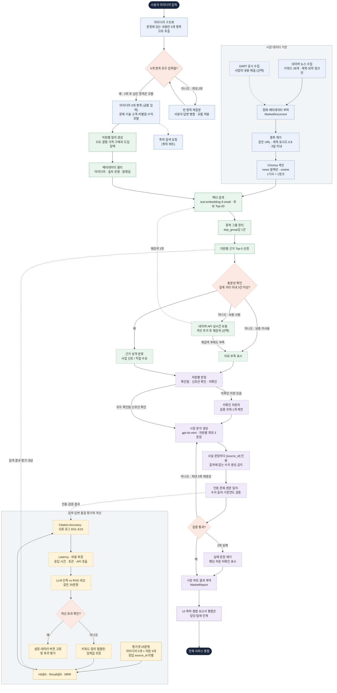

# 시장 조사 설계

아이디어 한 문장을 5개 항목으로 구조화한 뒤, 수요·경쟁/대체재·가격·구매자·도입장벽 5개 차원별로
시장 근거를 검색하고, 출처가 확인된 문장만으로 시장 분석 결과를 만든다.

## 처리 흐름

- 색: 파랑 = 입력·데이터 준비, 초록 = 검색, 보라 = 분석 생성·검증, 노랑 = 평가, 주황 = 판단 분기
- 점선 테두리: 아직 구현되지 않은 단계 / 점선 화살표: 선택 단계, 평가 연결, 다른 파트로의 인계
- 아이디어 5개 항목(`StructuredIdea`)은 특허 파트와 공통 입력이며, UI·보고서 통합(파트 1·4)은 시장 파트의 출력 경계다.
- 재시도 상한: 빈 항목 재질문 2회, 실시간 보충 후 재검색 1회, 인용 검증 실패 시 재생성 최대 2회.
- 재질문 후에도 비어 있는 항목은 모름으로 표시하고, 해당 항목에 기대는 차원은 미확인으로 판정한다(예: 수익모델 모름 → 가격 미확인).

## 아이디어 5개 항목

| 항목 | 필드 | 주로 쓰는 시장 차원 |
|---|---|---|
| 문제 | `problem` | 수요 |
| 기술 | `technology` | 전 차원 |
| 고객 | `customers` | 수요·구매자·도입장벽 |
| 차별점 | `difference` | 경쟁/대체재 |
| 수익모델 | `revenue` | 가격 |

## 단계별 코드 위치

| 단계 | 위치 |
|---|---|
| 아이디어 구조화·재질문 | `prompts/idea_parser.md`, `src/generation/idea_parser.py` |
| 수집 키워드·요청 설정 | `configs/market_keywords.yaml` |
| 네이버 뉴스 수집 | `src/ingestion/news_client.py` → `data/market/raw/` |
| DART 공시 수집 | `src/ingestion/dart_client.py` |
| 정제·중복 제거 | `src/ingestion/market_processor.py` → `data/market/processed/market_docs.jsonl` |
| 색인·차원별 검색 툴 | `src/retrieval/market_search.py` → `data/market/chroma/` |
| 시장 조사 진입점 | `src/services/market_service.py` |
| 시장 분석 생성 규칙 | `prompts/market_analysis.md`, `src/generation/market_analysis.py` |
| 데이터 형식·결과 계약 | `src/schemas.py` (`MarketDocument`, `MarketSearchRequest`, `MarketReport`) |
| 평가 문항·정답 라벨 | `evaluation/market_cases.json`, `evaluation/labels/`, `evaluation/market_labeling.py`, `evaluation/market_judge.py` |
| 검색 평가 실행·결과 | `evaluation/evaluate.py` → `evaluation/results/` |
