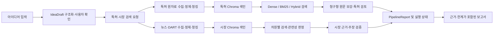

# IdeaLens RAG 학습 안내서

이 문서는 IdeaLens의 RAG 흐름을 실제 코드 순서대로 읽고, 검색 결과가 근거가 연결된 보고서가 되는 과정을 학습하기 위한 안내서다. 문서에 적힌 설계와 현재 실행 경로가 다를 수 있으므로 호출부·스키마·테스트를 함께 확인한다.

## 학습 목표와 권장 순서

학습을 마치면 다음을 설명할 수 있어야 한다.

- 원자료가 출처와 메타데이터를 유지한 채 검색 문서와 청크가 되는 과정
- Dense, BM25, Hybrid 검색이 후보를 만들고 정렬하는 방식
- 특허와 시장 근거가 각각 검증된 보고서로 변환되는 경로
- 부분 실패, 미확인 정보, 실행 상태가 결과에 남는 방식
- 검색 품질을 고정 평가 조건과 사람 라벨로 비교하는 방법

한 번에 전체 코드를 읽기보다 아래 순서로 따라간다.

1. `src/idea_schemas.py`, `src/patent_schemas.py`, `src/market_schemas.py`에서 입력·검색 요청·근거·보고서 계약을 읽는다. `src/schemas.py`는 기존 호출부를 위한 재수출 경계다.
2. `src/ingestion/patent_processor.py`, `src/ingestion/market_processor.py`, `src/ingestion/dart_processor.py`에서 원자료가 정규화·청킹되는 방식을 읽는다.
3. `src/retrieval/adapters.py`, `src/retrieval/patent_store.py`, `src/retrieval/market_search.py`에서 검색 문서 변환과 색인을 읽는다.
4. `src/retrieval/engine.py`, `src/retrieval/patent_search.py`에서 후보 점수·결합·중복 제거·정렬을 읽는다.
5. `src/services/patent_service.py`, `src/services/market_service.py`, `src/pipeline.py`, `src/pipeline_execution.py`에서 서비스 흐름과 부분 실패를 읽는다.
6. `src/generation/patent_analysis.py`, `src/generation/market_analysis.py`, `src/generation/market_claims.py`, `prompts/`에서 근거가 분석 주장으로 변환·검증되는 방식을 읽는다.
7. `src/pipeline_models.py`, 화면의 `frontend/` 보고서 모듈, 대응 테스트와 `evaluation/`을 보며 결과 상태와 품질 검증을 확인한다.

## 한눈에 보는 데이터 흐름

색인 생성과 사용자 질의 분석은 구분한다. 특허 색인 생성은 문헌을 임베딩해 저장하는 오프라인 준비 작업이고, 검색은 저장된 청크를 질의에 맞춰 찾는 온라인 작업이다. 분석 실행은 검색 결과를 관련성 판정·원문 확인·보고서 생성으로 이어간다.

## 1. 계약에서 출발하기

도메인 간 전달 형식은 Pydantic 모델로 정의한다.

- 아이디어: `src/idea_schemas.py`의 `IdeaDraft`, `StructuredIdea`
- 특허: `src/patent_schemas.py`의 검색 요청, 특허 문서·청크·근거·보고서 모델
- 시장: `src/market_schemas.py`의 문서·근거·차원별 주장·보고서 모델
- 통합 상태: `src/pipeline_models.py`의 준비 상태·영역별 실행 결과·파이프라인 결과
- 공통 검색 결과: `src/retrieval/schemas.py`의 `SearchDocument`, `RetrievalResult`

계약을 읽을 때는 데이터가 어디서 만들어지고 다음에 누가 읽는지 추적한다. 특히 문헌 ID, 청크 ID, citation ID, 원문 인용, 검색 범위, 상태가 보고서까지 살아남는지 확인한다. 필드를 추가하거나 이름을 바꾸면 생성자와 직렬화·화면·내보내기 소비처를 모두 찾아야 한다.

## 2. 원자료에서 청크까지

### 특허

`src/ingestion/patent_processor.py`의 `to_patent_document()`은 KIPRIS 결과를 내부 `PatentDocument`로 바꾼다. 출원번호를 문헌 식별자로 쓰며, `structure_claims()`는 항 번호·원문·독립/종속항 구분·참조 항·버전을 정리한다. `build_chunks()`는 초록을 한 청크로, 구조화된 각 청구항을 항별 청크로 만든다. 청구항 번호와 상위항 정보가 이후 근거 문맥에 활용된다.

특허 검색은 현재 초록과 청구항 중심이다. 명세서의 모든 섹션을 검색 색인에 넣는다고 가정하지 않는다. 원문 청구항 상세는 검색 후 선택 문헌에 대해 보강될 수 있으므로 색인 청크와 최종 비교에 전달되는 원문 범위가 같지 않을 수 있다.

### 시장 자료

뉴스 수집은 `src/ingestion/news_client.py`, 시장 뉴스 정제는 `src/ingestion/market_processor.py`, DART 사업보고서 처리는 `src/ingestion/dart_processor.py`가 맡는다. 뉴스는 제목·요약 중심의 문서이며, DART는 사업 내용 섹션 텍스트를 청크로 나눈다. 문서의 출처 유형, URL, 날짜 등은 검색 후 근거를 표시하고 인용 ID를 연결하는 데 쓰인다.

뉴스 요약은 기사 전문이 아니다. 출처의 성격과 텍스트 범위를 확인하지 않고 요약을 원문 인용처럼 취급하면 안 된다. DART 처리에서 표가 제외되는 경우 표에만 있는 값은 그 색인으로 검증할 수 없다.

## 3. 색인과 임베딩

`src/retrieval/patent_store.py`와 `src/retrieval/market_search.py`는 문서 내용을 Chroma 레코드(ID·텍스트·메타데이터)로 바꾸고 선택한 임베딩 provider의 벡터를 저장한다. 특허 색인은 청크 ID를 유지하며, 내용이 바뀐 청크는 배치 단위로 임베딩·upsert한다. 같은 내용의 메타데이터 변경은 재임베딩 없이 메타데이터를 갱신한다. 시장 색인은 문서 ID와 아이디어 범위 등 메타데이터를 함께 관리한다.

`src/llm_client.py`는 `LLM_PROVIDER`에 따라 OpenAI 또는 Ollama의 OpenAI 호환 API 주소와 채팅·임베딩 모델 이름을 선택한다. Ollama 모드에서 채팅·임베딩 요청을 로컬 모델 서버로 보낼 수 있지만 KIPRIS, NAVER, DART, 공용 Chroma 같은 별도 데이터 서비스 연결까지 로컬로 바뀌는 것은 아니다. 각 호출부의 provider 선택과 데이터 전송 경계를 따로 확인한다. 임베딩 모델이 바뀌면 벡터 공간도 달라지므로 기존 임베딩을 다른 모델의 임베딩과 섞어 쓰지 않도록 컬렉션 분리 설정을 확인한다.

색인 작업은 외부 API 호출과 비용을 만들 수 있다. 학습 중에는 실제 색인 생성 명령을 실행하지 말고, 테스트의 모의 임베딩·임시 컬렉션을 사용한다. 실제 실행 전에는 대상 데이터, 호출 수, 저장 위치, 선택한 모델을 확인한다.

## 4. 검색 방식 읽기

공통 검색 엔진은 `src/retrieval/engine.py`에 있다.

| 방식 | 현재 코드의 의미 | 학습할 때 볼 점 |
|---|---|---|
| Dense | 벡터 백엔드의 질의 유사도 순위를 사용 | 질의 임베딩 호출, 벡터 후보 수, 문헌 중복 제거 |
| BM25 | 제목과 본문 토큰의 통계 점수로 순위를 계산 | 토큰화, 코퍼스 범위, 분야·메타데이터 필터 |
| Hybrid | Dense 순위와 BM25 순위를 RRF 방식으로 결합 | RRF 상수, 두 후보의 범위 차이, 결합 뒤 후보 제한 |
| Reranker | 선택적으로 후보 목록에 별도 점수를 매겨 재정렬 | 모델 다운로드·호출 비용, 후보 수, 실패 처리 |

`RetrievalConfig`는 후보 수, 최종 결과 수, RRF 상수, 원문 단위 중복 제거, 필터를 묶는다. 검색 결과는 공통 `RetrievalResult`에 점수·순위와 문서를 담는다. 점수는 방식마다 정의가 다르므로 서로 다른 모드의 원점수를 같은 척도라고 해석하지 않는다.

현재 구현의 중요한 성능 제약도 학습 대상이다. 특허 Dense 경로는 분야에 해당하는 ID 확인 후 벡터 상위 후보를 읽는다. 특허 BM25/Hybrid 경로는 해당 분야의 문서와 메타데이터를 전체 조회해 메모리에서 BM25를 계산한다. 이것은 코드에서 확인된 구조이지, 모든 배포 환경에서 문제가 되는 지연시간이라는 계측 결론은 아니다. 후보 로딩 병목을 바꾸려면 동일 코퍼스·고정 라벨에서 품질과 시간·메모리를 함께 비교해야 한다.

시장 검색은 `src/retrieval/market_search.py`에 별도 도메인 규칙이 있다. 아이디어의 다섯 항목으로 시장 차원별 질의를 구성하고 뉴스와 DART 결과를 별도 검색·결합한다. 검색 모드와 필터를 공통 엔진에서 재사용하더라도 도메인별로 후보 구성 방식은 다를 수 있다.

## 5. 검색에서 근거 보고서까지

### 특허 경로

`src/services/patent_service.py`의 `analyze_patents()`가 서비스 경계다. 기술 요소별 질의 계획을 만들고 로컬 색인을 검색하며, 설정과 결과 상태에 따라 KIPRIS 검색 결과를 보충한다. 후보는 문헌 단위로 모으고 관련성 판정 후 일부 문헌의 청구항 원문을 보강한다. `src/services/patent_context.py`에서 비교에 쓸 청구항과 상위항 문맥을 선택한다. 생성된 인용은 `validate_patent_citations()`에서 제공 원문에 실제로 포함되는지 검사한다.

원문 문자열 안에 인용이 존재한다는 검사는 “인용이 주장 자체를 충분히 지지한다”는 논리적 판정과 다르다. 특허 분석은 예비 비교이며 침해·등록 가능성·자유실시의 법률 결론을 대신하지 않는다.

### 시장 경로

`src/services/market_service.py`가 `MarketReport` 생성 흐름을 조립한다. `src/retrieval/market_relevance.py`의 관련성 판정은 검색 결과가 아이디어와 관계되는지, 어떤 성격의 신호인지 평가한다. `src/generation/market_analysis.py`가 차원별 분석을 만들고 `src/generation/market_claims.py`와 `src/generation/market_evidence.py`가 주장·citation ID·근거 관계를 검증하고 표현한다.

시장 주장은 사실, 사용자 주장, AI 가설의 성격을 구분한다. 뉴스·기업 공시·조달 공고·검색 관심도는 서로 다른 증거다. 검색 관심도와 키워드 동시 출현은 구매 의사를 직접 입증하지 않는다. 근거가 충분하지 않으면 상태와 한계를 남긴다.

### 통합 파이프라인

`src/pipeline.py`와 `src/pipeline_execution.py`가 특허·시장 조사 실행을 조정한다. 두 영역의 실행 결과는 각각 상태로 보존되며 한 영역의 예외가 다른 영역의 결과를 지우지 않도록 설계되어 있다. `PartRun`의 완료·무결과·오류·건너뜀·시간 초과 상태와 최종 `PipelineReport`를 따라가며 부분 성공이 UI와 보고서까지 유지되는지 확인한다.

타임아웃은 이미 외부로 전송한 요청을 반드시 취소한다는 뜻은 아니다. 화면 이동과 상태 복원은 `frontend/`의 작업 흐름 및 보고서 기록 코드를 확인한다. UI 이동만으로 분석 함수를 다시 부르지 않는지, 기존 분석 결과를 재사용하는지 테스트를 통해 학습한다.

## 6. 평가: 개선 여부를 어떻게 말할 수 있나

평가 도구는 `evaluation/`에 있다. 검색과 생성의 평가를 한 숫자로 합치지 않는다.

- 특허 검색: `evaluation/patent_cases.json`, 후보 라벨, `evaluation.evaluate`를 확인한다. 특허 질의의 정답 라벨이 모두 채워졌는지 먼저 확인한다. 현재 기준선 문서에 따르면 특허 평가 후보는 사람 판정 전에는 품질 지표 산출에 쓸 수 없다.
- 시장 검색: `evaluation/market_cases.json`, 사람 라벨 및 `evaluation/results/`를 확인한다. 저장된 CSV는 과거 실행 산출물이지 지금 재실행한 결과가 아니다. 현재 색인과 지문·실행 조건이 같다고 가정하지 않는다.
- 인용·주장: `evaluation/patent_groundedness.py`, `evaluation/market_answer_eval.py`, `evaluation/guardrail_eval.py`와 각 라벨 가이드를 확인한다. 검색 적중은 인용 정확성이나 주장의 근거 지지를 자동으로 증명하지 않는다.
- 운영: 검색 시간, 후보 수, 임베딩·생성 호출, 토큰·비용 기록이 평가에 실제로 포함되는지 확인한다. 기록되지 않은 수치를 성능 개선 근거로 만들지 않는다.

비교 실험은 질의·라벨·색인 지문을 고정하고 한 요소만 바꾼다. 예를 들어 후보 수를 비교할 때 reranker와 검색 모드는 그대로 둔다. 후보 제한을 바꿔 새 문헌이 결과에 나타났다면 그 문헌부터 사람 판정한다. 측정 대상은 다음처럼 나눈다.

1. 검색: Recall@k, Precision@k, MRR, nDCG
2. 근거: citation 존재·문서 소속·원문 일치·주장 지지 여부
3. 답변: 사실 오류, 빠진 내용, 과도한 결론, 미확인 처리
4. 운영: 지연시간, 호출 수, 토큰·비용, 오류율

한 지표의 개선을 전체 RAG 품질 향상으로 확대 해석하지 않는다. 평가 라벨이 없거나 실행 지문이 다르면 “비교 불가” 또는 “탐색 결과”라고 기록한다.

## 7. 안전한 실습

아래 실습은 코드 읽기와 기존 자동 테스트를 우선하며 외부 API나 실제 색인을 변경하지 않는다.

### 실습 A: 문헌 하나의 추적 경로 만들기

1. 특허 fixture 또는 테스트 데이터를 선택한다.
2. `PatentDocument`의 ID·초록·청구항 정보를 확인한다.
3. `build_chunks()` 결과의 chunk ID와 metadata를 기록한다.
4. `to_chroma_record()`에서 검색 문서와 Chroma record 필드의 대응을 그린다.
5. 검색 결과에서 `PatentEvidence`의 citation ID와 원문 확인 함수까지 이어지는 호출 경로를 적는다.

완료 기준: 원문 한 조각이 문서 ID → 청크 ID → 검색 후보 → citation ID → 보고서 출처로 연결된다.

### 실습 B: 검색 모드 테스트 읽기

1. `tests/test_patent.py`, `tests/test_market_search.py`, `tests/test_retrieval_engine.py`에서 dense·BM25·hybrid 테스트를 찾는다.
2. 동일 질의와 후보에서 순위가 달라지는 이유를 `engine.py`의 점수·정렬 코드로 설명한다.
3. 문헌 단위 중복 제거와 분야 필터의 경계 사례를 확인한다.

완료 기준: 테스트의 입력, 기대 순위, 관련 `RetrievalConfig`가 설명된다. 테스트 파일이 다르면 `rg`로 실제 위치를 찾는다.

### 실습 C: 부분 실패 상태 확인

1. `tests/test_pipeline*`에서 특허 또는 시장 한쪽 실패 사례를 찾는다.
2. 한쪽 결과가 실패할 때 반대편 결과와 `PartRun` 상태가 유지되는지 추적한다.
3. 타임아웃 후 in-flight 요청에 관한 제한을 설명한다.

완료 기준: 양쪽 독립 결과와 최종 상태를 구분해 설명한다.

### 실습 D: 평가 라벨과 결과 산출물 점검

1. 특허·시장 사례 JSON과 CSV의 데이터 구조를 비교한다.
2. 라벨 미판정 사례와 저장된 평가 결과가 어떻게 분리되는지 확인한다.
3. 사람 검토 없이 성능 수치를 말할 수 없는 경우를 적는다.

완료 기준: 데이터셋 지문, 라벨 상태, 검색 지표, 실행 커밋이 결과 해석에 미치는 영향을 설명한다.

## 8. 코드 탐색 질문

각 단계에서 다음 질문을 답하며 읽는다.

- 문서 ID와 청크 ID는 언제 생성되고, 갱신된 문서는 어떤 조건으로 재임베딩되는가?
- 메타데이터 필터가 벡터 검색과 BM25 양쪽에 같은 의미로 적용되는가?
- Hybrid 후보군에 한쪽 검색만 나타난 문서는 어떻게 처리되는가?
- 중복 제거 전에 후보를 자르는가, 자른 뒤에 하는가? 결과에 어떤 영향이 있는가?
- 인용이 원문 안에 있다는 검사와 주장을 지지한다는 판단은 어디서 각각 이뤄지는가?
- 한 출처 서비스가 실패할 때 보고서 상태와 다른 출처 결과는 어떻게 보존되는가?
- 모델 provider 변경 시 채팅 요청, 임베딩, 컬렉션 분리가 각각 어떤 설정을 따르는가?
- 결과를 UI에서 다시 열 때 분석·임베딩·외부 수집이 재실행되는가?
- 평가 결과가 어느 데이터·라벨·색인·설정·코드 버전에 대해 유효한가?

## 용어

| 용어 | 의미 |
|---|---|
| 청크 | 검색 단위로 나눈 텍스트. 특허는 초록 또는 개별 청구항을 기본 단위로 사용한다. |
| 임베딩 | 텍스트의 의미적 유사도를 계산하기 위해 모델이 만드는 벡터 표현 |
| Dense 검색 | 벡터 간 거리를 이용하는 의미 검색 |
| BM25 | 질의 토큰과 문서 토큰 통계를 이용하는 어휘 검색 점수 |
| RRF | 여러 검색 순위를 역순위 점수로 결합하는 방식 |
| Reranker | 검색 후보를 별도 모델 점수로 다시 정렬하는 단계 |
| Citation ID | 보고서 근거를 검색 결과·원문으로 연결하는 식별자. 특허는 `P:`, 시장은 `M:` 접두 규약을 사용한다. |
| 근거 추적성 | 주장의 출처, 원문 범위, 검색·분석 상태까지 다시 확인할 수 있는 성질 |
| 부분 완료 | 분석 일부는 유효하게 끝났지만 다른 영역이나 단계는 실패·시간 초과·미확인인 상태 |

## 참고 문서

- [전체 아키텍처](architecture.md)
- [RAG 서비스 기준선과 현재 확인 한계](rag-service-baseline.md)
- [특허 청구항 분석 계약·검색 평가](patent_rag.md)
- [시장 조사 흐름](market_research.md)
- [API와 파이프라인 데이터 계약](api_contract.md)
- [개발·실행 지침](development.md)
